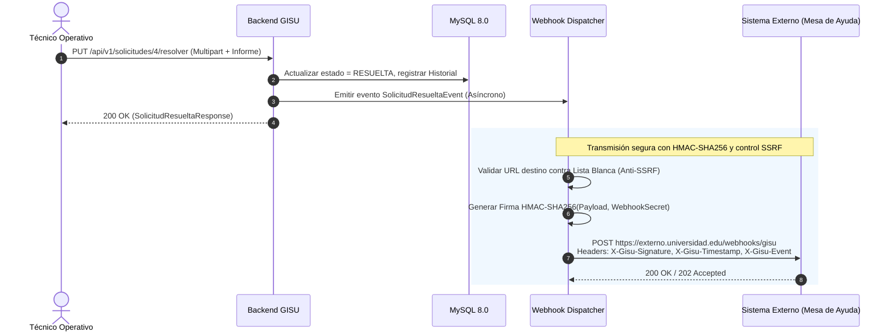

# Especificación de la API REST

> **Fuente única de los contratos de la API.** Los `specs/` describen el comportamiento (BDD) y apuntan aquí para el detalle de rutas y JSON. La API real se documenta además de forma ejecutable con **OpenAPI/Swagger** (§7); si hubiera diferencia, se corrige este documento o el código en el mismo PR.
> Relacionados: [SRS](../01-definicion/especificaciones-tecnicas.md) · [Arquitectura §2 y §8](arquitectura-tecnica.md) · [Seguridad](../03-calidad-y-operacion/seguridad-owasp.md) · [Pruebas](../03-calidad-y-operacion/estrategia-pruebas.md)

---

## 1. Convenciones generales

| Aspecto | Convención |
|:---|:---|
| **Base URL** | `https://<host>/api/v1` (en desarrollo: `http://localhost:8080/api/v1`). |
| **Versionado** | Prefijo en la ruta (`/v1`). Cambios incompatibles → `/v2`; los compatibles (campos nuevos opcionales) no suben versión. |
| **Formato** | JSON UTF-8 (`application/json`). Archivos: `multipart/form-data`. Errores: `application/problem+json` (RFC 7807). |
| **Nombres** | Rutas en minúsculas con guiones (`mis-solicitudes`); campos JSON en `camelCase`; recursos en plural. |
| **Fechas** | ISO-8601 en **UTC** con sufijo `Z` (`2026-10-03T15:04:05Z`). El frontend convierte a `America/Lima`. |
| **Autenticación** | Cabecera `Authorization: Bearer <JWT>` salvo los endpoints públicos (§4). |
| **Identificadores en ruta** | Id numérico (`/solicitudes/150`). El **código** (`SOL-2026-0150`) es el identificador visible para personas y se devuelve siempre en el cuerpo. |
| **Idempotencia** | `GET`, `PUT` y `DELETE` son idempotentes; una transición repetida responde 409 (ya no es válida), nunca duplica efectos. |
| **Paginación** | `?page=0&size=20&sort=fechaRegistro,desc`. `size` por defecto 20, máximo 100. Respuesta: ver §2.3. |
| **Filtros** | Parámetros de consulta opcionales y combinables; los valores desconocidos se ignoran, los inválidos devuelven 400. |
| **Trazabilidad** | Toda respuesta incluye `X-Trace-Id`. Se acepta `traceparent` (W3C) entrante. |
| **Límites** | Cuerpo JSON ≤ 100 KB; archivos ≤ 5 MB c/u, ≤ 3 por petición; *rate limit* de login por IP (429). |
| **CORS** | Solo orígenes de `ALLOWED_ORIGINS`; métodos `GET, POST, PUT, DELETE, OPTIONS`; cabeceras `Authorization, Content-Type`. |

### 1.1 Códigos HTTP usados

| Código | Cuándo |
|:---:|:---|
| **200 OK** | Lectura o actualización correcta con cuerpo. |
| **201 Created** | Recurso creado; incluye cabecera `Location`. |
| **204 No Content** | Operación correcta sin cuerpo (baja lógica, cambio de contraseña). |
| **400 Bad Request** | Validación fallida, JSON mal formado, HTML en texto (RN-18), parámetro inválido. |
| **401 Unauthorized** | Sin token, token inválido/expirado, credenciales incorrectas o cuenta inactiva. |
| **403 Forbidden** | Autenticado pero su **rol** no permite la operación. |
| **404 Not Found** | No existe **o está fuera del alcance** del usuario (RN-16). |
| **409 Conflict** | Transición de estado no permitida (RN-06); duplicado (correo, nombre de catálogo). |
| **413 Payload Too Large** | Archivo > 5 MB. |
| **415 Unsupported Media Type** | Tipo de archivo no permitido. |
| **429 Too Many Requests** | Límite de peticiones excedido. |
| **500 Internal Server Error** | Error no controlado (mensaje genérico + `traceId`). |

### 1.2 Estructura de error (RFC 7807)

```json
{
  "type": "https://servicios.universidad.edu/problemas/transicion-invalida",
  "title": "Transición de estado no permitida",
  "status": 409,
  "detail": "La solicitud debe estar EN_ATENCION para ser resuelta (estado actual: REGISTRADA).",
  "instance": "/api/v1/solicitudes/150/resolver",
  "timestamp": "2026-10-03T15:04:05Z",
  "traceId": "4bf92f3577b34da6a3ce929d0e0e4736"
}
```
Para 400 se añade `errores`: mapa `campo → mensaje`. Ejemplos por código en [Arquitectura §8](arquitectura-tecnica.md#8-manejo-centralizado-de-errores).

---

## 2. Modelos comunes

### 2.1 `UsuarioResumen`
```json
{ "id": 7, "nombre": "Juan", "apellido": "Pérez", "correo": "juan@universidad.edu",
  "rol": "ESTUDIANTE", "idArea": null }
```
`rol` se devuelve **sin** prefijo `ROLE_`. Nunca se devuelve `passwordHash`.

### 2.2 `SolicitudResumen` (listados)
```json
{ "id": 150, "codigo": "SOL-2026-0150", "titulo": "Proyector sin imagen",
  "categoria": "Equipos de Cómputo", "area": "Tecnologías de la Información",
  "prioridad": "ALTA", "estado": "ASIGNADA",
  "solicitante": "Juan Pérez", "tecnico": "Carlos Ruiz",
  "fechaRegistro": "2026-10-03T15:04:05Z", "fechaLimiteSla": "2026-10-04T15:04:05Z", "vencida": false }
```

### 2.3 `Page<T>`
```json
{ "content": [ /* … */ ], "page": 0, "size": 20, "totalElements": 134, "totalPages": 7 }
```

---

## 3. Catálogo de endpoints

> Leyenda de acceso: **P** público · **A** cualquier usuario autenticado · **E** `ESTUDIANTE` · **T** `TECNICO` · **S** `SUPERVISOR` · **D** `ADMIN`. El alcance de datos de cada rol (RN-16) se aplica siempre. Tabla consolidada en §4.

### 3.1 Autenticación — `/auth`

| Método y ruta | Acceso | Descripción | Éxito | Errores |
|:---|:---:|:---|:---:|:---|
| `POST /auth/login` | P | Inicia sesión | 200 | 400, 401, 429 |
| `POST /auth/registro` | P | Autoregistro de estudiante (rol forzado) | 201 | 400, 409 |
| `GET /auth/me` | A | Perfil del usuario autenticado | 200 | 401 |
| `PUT /auth/cambiar-password` | A | Cambia la contraseña propia | 204 | 400, 401 |

*Cerrar sesión no tiene endpoint:* al ser *stateless*, el cliente elimina el token ([ADR-004](decisiones-arquitectura.md#adr-004--jwt-de-8-horas-sin-refresh-token)).

**`POST /auth/login`**
```json
// Request
{ "correo": "juan@universidad.edu", "password": "Password123" }

// 200 OK
{ "token": "eyJhbGciOiJIUzI1NiJ9...", "tipo": "Bearer", "expiraEn": 28800,
  "usuario": { "id": 7, "nombre": "Juan", "apellido": "Pérez",
               "correo": "juan@universidad.edu", "rol": "ESTUDIANTE", "idArea": null } }

// 401 (mismo mensaje para correo inexistente, clave errónea o cuenta inactiva)
{ "type": ".../no-autenticado", "title": "No autenticado", "status": 401,
  "detail": "Credenciales inválidas", "traceId": "…" }
```
Validación: `correo` formato email y obligatorio; `password` obligatoria.

**`POST /auth/registro`**
```json
// Request (no admite el campo "rol": si llega, se rechaza con 400)
{ "codigoInstitucional": "U20261045", "nombre": "Juan", "apellido": "Pérez",
  "correo": "juan@universidad.edu", "password": "Password123" }
// 201 Created → mismo cuerpo que login (inicio de sesión automático)
```
| Campo | Regla |
|:---|:---|
| `codigoInstitucional` | Obligatorio, `^[A-Za-z0-9]{6,20}$`, único. |
| `nombre`, `apellido` | 2–50 caracteres, sin HTML. |
| `correo` | Dominio `ALLOWED_EMAIL_DOMAIN` (RN-02), único (409 si existe). |
| `password` | RN-03: ≥ 8, 1 mayúscula, 1 número. |

**`PUT /auth/cambiar-password`**: `{ "passwordActual": "…", "nuevaPassword": "…" }` → 204. Si `passwordActual` es errónea → 400 (`errores.passwordActual`).

---

### 3.2 Solicitudes — `/solicitudes`

| Método y ruta | Acceso | Descripción | Éxito | Errores |
|:---|:---:|:---|:---:|:---|
| `POST /solicitudes` | A | Registra una solicitud (multipart) | 201 | 400, 413, 415 |
| `GET /solicitudes/mis-solicitudes` | A | Solicitudes registradas por el usuario | 200 | 400 |
| `GET /solicitudes` | T, S, D | Bandeja con filtros (alcance por rol) | 200 | 400, 403 |
| `GET /solicitudes/{id}` | A* | Detalle (*si está en su alcance) | 200 | 404 |
| `GET /solicitudes/{id}/historial` | A* | Línea de tiempo inmutable | 200 | 404 |
| `PUT /solicitudes/{id}/evaluar` | S, D | `REGISTRADA → EN_EVALUACION` | 200 | 403, 404, 409 |
| `PUT /solicitudes/{id}/asignar` | S, D | Asigna o reasigna técnico → `ASIGNADA` | 200 | 400, 403, 404, 409 |
| `PUT /solicitudes/{id}/iniciar-atencion` | T (asignado), D | `ASIGNADA → EN_ATENCION` | 200 | 403, 404, 409 |
| `PUT /solicitudes/{id}/resolver` | T (asignado), D | `EN_ATENCION → RESUELTA` (multipart) | 200 | 400, 403, 404, 409, 413, 415 |
| `PUT /solicitudes/{id}/cerrar` | Solicitante, S, D | `RESUELTA → CERRADA` | 200 | 400, 403, 404, 409 |

**`POST /solicitudes`** — `Content-Type: multipart/form-data` con dos partes:

| Parte | Tipo | Obligatoria | Contenido |
|:---|:---|:---:|:---|
| `solicitud` | `application/json` | Sí | Datos de la solicitud (abajo) |
| `archivos` | archivo(s) | No | 0–3 evidencias JPG/PNG/PDF ≤ 5 MB c/u |

```json
// Parte "solicitud"
{ "idCategoria": 2, "idPrioridad": 3, "titulo": "Proyector sin imagen",
  "descripcion": "El proyector del aula B-402 enciende pero no muestra imagen por HDMI.",
  "ubicacionCampus": "Campus Central", "ubicacionAmbiente": "Pabellón B - Aula 402" }

// 201 Created   Location: /api/v1/solicitudes/150
{ "id": 150, "codigo": "SOL-2026-0150", "estado": "REGISTRADA",
  "fechaRegistro": "2026-10-03T15:04:05Z", "fechaLimiteSla": "2026-10-04T15:04:05Z",
  "mensaje": "Solicitud registrada con éxito" }
```
| Campo | Regla |
|:---|:---|
| `idCategoria`, `idPrioridad` | Obligatorios; deben existir y estar activos (si no, 400). |
| `titulo` | 5–150 caracteres, sin HTML. |
| `descripcion` | 15–500 caracteres, sin HTML. |
| `ubicacionCampus`, `ubicacionAmbiente` | Obligatorios, ≤ 100, sin HTML. |
| Archivos | RN-15; si alguno falla, **no se crea nada** (400/413/415). |

**`GET /solicitudes`** — filtros: `estado` (uno o varios, repetible), `idPrioridad`, `idCategoria`, `idTecnico`, `q` (texto en código o título), `desde`, `hasta` (fecha de registro), `vencidas=true`, `page`, `size`, `sort`. Respuesta `Page<SolicitudResumen>`. Alcance: técnico → asignadas a él; supervisor → su área; admin → todas. Un `ESTUDIANTE` recibe 403 (debe usar `mis-solicitudes`).

**`GET /solicitudes/{id}`**
```json
{ "id": 150, "codigo": "SOL-2026-0150", "titulo": "Proyector sin imagen",
  "descripcion": "…", "ubicacionCampus": "Campus Central", "ubicacionAmbiente": "Pabellón B - Aula 402",
  "categoria": { "id": 2, "nombre": "Equipos de Cómputo" },
  "area": { "id": 1, "nombre": "Tecnologías de la Información" },
  "prioridad": "ALTA",
  "estado": { "codigo": "ASIGNADA", "nombreVisible": "Asignada", "colorHex": "#2563EB" },
  "solicitante": { "id": 7, "nombre": "Juan", "apellido": "Pérez" },
  "tecnico": { "id": 14, "nombre": "Carlos", "apellido": "Ruiz" },
  "informeResolucion": null,
  "fechaRegistro": "…", "fechaLimiteSla": "…", "fechaResolucion": null, "fechaCierre": null,
  "vencida": false,
  "evidencias": [ { "id": 31, "tipo": "INICIAL", "nombre": "foto_proyector.jpg", "mimeType": "image/jpeg", "tamanoBytes": 1534021 } ],
  "accionesPermitidas": [ "COMENTAR" ] }
```
`accionesPermitidas` lista lo que el usuario actual puede hacer sobre esa solicitud (`EVALUAR`, `ASIGNAR`, `INICIAR_ATENCION`, `RESOLVER`, `CERRAR`, `COMENTAR`); el frontend la usa para mostrar u ocultar botones sin duplicar reglas.

**`GET /solicitudes/{id}/historial`**
```json
[ { "fecha": "2026-10-03T15:04:05Z", "usuario": "Juan Pérez", "estadoAnterior": null, "estadoNuevo": "REGISTRADA", "nota": null },
  { "fecha": "2026-10-03T16:10:00Z", "usuario": "Ana Torres", "estadoAnterior": "REGISTRADA", "estadoNuevo": "EN_EVALUACION", "nota": null },
  { "fecha": "2026-10-03T16:10:00Z", "usuario": "Ana Torres", "estadoAnterior": "EN_EVALUACION", "estadoNuevo": "ASIGNADA", "nota": "Asignada a Carlos Ruiz" } ]
```

**Transiciones (cuerpos JSON):**

| Endpoint | Cuerpo | Validación |
|:---|:---|:---|
| `PUT …/evaluar` | `{ "idPrioridad": 4, "nota": "…" }` (ambos opcionales) | `idPrioridad` activo; nota ≤ 255 |
| `PUT …/asignar` | `{ "idTecnico": 14, "nota": "…" }` | Técnico activo del área de la categoría (RN-07) |
| `PUT …/iniciar-atencion` | *(sin cuerpo)* | — |
| `PUT …/cerrar` | `{ "nota": "Conforme con la solución" }` (opcional) | ≤ 255 |

**`PUT …/resolver`** — `multipart/form-data`: parte `datos` (JSON `{ "informe": "Se reemplazó el cable HDMI dañado" }`, ≥ 20 caracteres) y parte `archivos` con **1–3** evidencias (obligatorias, RN-12).

Respuesta de todas las transiciones: **200** con el `SolicitudDetalle` actualizado.

---

### 3.3 Comentarios y evidencias

| Método y ruta | Acceso | Descripción | Éxito | Errores |
|:---|:---:|:---|:---:|:---|
| `GET /solicitudes/{id}/comentarios` | A* | Comentarios visibles para el rol (RN-19) | 200 | 404 |
| `POST /solicitudes/{id}/comentarios` | A* | Crea comentario | 201 | 400, 404, 409 |
| `GET /solicitudes/{id}/evidencias/{idEvidencia}` | A* | Descarga autenticada del archivo | 200 | 404 |

`POST …/comentarios`: `{ "comentario": "El técnico llegará a las 3pm", "privado": false }`. `privado=true` solo lo aceptan `TECNICO`, `SUPERVISOR`, `ADMIN` (si un estudiante lo envía → 403). Si la solicitud está en estado final → 409.

---

### 3.4 Dashboard — `/dashboard`

Todos aceptan `desde` y `hasta` (fechas ISO, por `fechaRegistro`; por defecto, últimos 30 días) y, solo para `ADMIN`, `idArea`. Acceso: **T, S, D**. El alcance depende del rol (RN-16): técnico → sus asignadas; supervisor → su área; admin → global o el `idArea` indicado. El estudiante recibe 403.

| Método y ruta | Respuesta |
|:---|:---|
| `GET /dashboard/kpis` | Objeto de KPIs (abajo) |
| `GET /dashboard/por-categoria` | `[{ "nombre": "Redes y Wi-Fi", "valor": 30 }]` |
| `GET /dashboard/por-prioridad` | `[{ "nombre": "ALTA", "valor": 12 }]` |
| `GET /dashboard/por-estado` | `[{ "nombre": "EN_ATENCION", "valor": 9, "colorHex": "#7C3AED" }]` |
| `GET /dashboard/por-responsable` | `[{ "nombre": "Carlos Ruiz", "valor": 18 }]` |
| `GET /dashboard/vencidas` | `Page<SolicitudResumen>` de solicitudes vencidas (RN-10) |

```json
// GET /dashboard/kpis
{ "desde": "2026-09-03T00:00:00Z", "hasta": "2026-10-03T23:59:59Z",
  "registradas": 150, "pendientes": 45, "atendidas": 98,
  "porcentajeResueltas": 70.5, "mttrHoras": 24.5, "vencidas": 7 }
```
Definiciones exactas en RN-11. Los arreglos `[{nombre, valor}]` se diseñaron para consumirse directamente por Recharts/Chart.js. `porcentajeResueltas` ∈ [0,100] con un decimal; `mttrHoras` es `null` si no hay resueltas.

---

### 3.5 Catálogos — `/areas`, `/categorias`, `/prioridades`, `/estados`

Las **lecturas** son para cualquier usuario autenticado (alimentan formularios); las **escrituras** solo para `ADMIN`. Los `GET` devuelven por defecto solo registros **activos** (RN-14); `?incluirInactivos=true` solo lo respeta para `ADMIN`.

| Recurso | Endpoints | Notas |
|:---|:---|:---|
| **Áreas** | `GET /areas` · `GET /areas/{id}` · `POST /areas` · `PUT /areas/{id}` · `DELETE /areas/{id}` · `PUT /areas/{id}/reactivar` | `DELETE` = baja lógica (204). No se puede desactivar un área con usuarios activos (409). |
| **Categorías** | `GET /categorias` (`?idArea=`) · `GET /categorias/{id}` · `POST` · `PUT /{id}` · `DELETE /{id}` · `PUT /{id}/reactivar` | `DELETE` = baja lógica (204). |
| **Prioridades** | `GET /prioridades` · `POST` · `PUT /{id}` · `DELETE /{id}` · `PUT /{id}/reactivar` | `slaMaxHoras` > 0; `nivel` único. |
| **Estados** | `GET /estados` · `PUT /estados/{codigo}` | **No** hay `POST` ni `DELETE`: el conjunto de estados es fijo ([ADR-009](decisiones-arquitectura.md#adr-009--los-estados-son-un-catálogo-de-presentación-no-de-comportamiento)). `PUT` solo cambia `nombreVisible`, `descripcion`, `colorHex`. |

```json
// POST /categorias  → 201 Created
{ "nombre": "Conectividad Wi-Fi", "descripcion": "Cobertura y fallas de red inalámbrica", "idArea": 1, "tiempoSlaHoras": 24 }

// 201 Created
{ "id": 7, "nombre": "Conectividad Wi-Fi", "descripcion": "…", "idArea": 1, "area": "Tecnologías de la Información",
  "tiempoSlaHoras": 24, "activo": true }
```
Reglas: `nombre` único (409), ≤ 80; `tiempoSlaHoras` ≥ 1; `idArea` existente y activo.

---

### 3.6 Usuarios y roles — `/admin/usuarios`, `/usuarios/tecnicos`, `/roles`

| Método y ruta | Acceso | Descripción | Éxito |
|:---|:---:|:---|:---:|
| `GET /admin/usuarios` | D | Lista paginada (`?rol=&idArea=&activo=&q=`) | 200 |
| `GET /admin/usuarios/{id}` | D | Detalle | 200 |
| `POST /admin/usuarios` | D | Crea usuario con cualquier rol | 201 |
| `PUT /admin/usuarios/{id}` | D | Edita datos, rol y área | 200 |
| `DELETE /admin/usuarios/{id}` | D | Baja lógica (no puede desactivarse a sí mismo) | 204 |
| `PUT /admin/usuarios/{id}/reactivar` | D | Reactiva | 200 |
| `GET /usuarios/tecnicos` | S, D | Técnicos activos (`?idArea=`); el supervisor solo ve **su** área | 200 |
| `GET /roles` | D | Lista de roles | 200 |

```json
// PUT /admin/usuarios/22   (promover a técnico: el área es obligatoria — RN-21)
{ "nombre": "Luis", "apellido": "Gómez", "telefono": "987654321", "rol": "TECNICO", "idArea": 2 }
// Si rol es TECNICO o SUPERVISOR y falta idArea → 400.  Si rol es ESTUDIANTE y llega idArea → 400.
```
Regla de seguridad: el último `ADMIN` activo no puede desactivarse ni cambiar de rol (409).

---

### 3.7 Operación (no versionados)

| Ruta | Acceso | Descripción |
|:---|:---:|:---|
| `GET /actuator/health` | P | Salud (*liveness/readiness*) para Docker y balanceador. |
| `GET /actuator/prometheus` | Red interna | Métricas; **no** se expone por el proxy público. |
| `GET /v3/api-docs`, `GET /swagger-ui.html` | P (solo dev/test) | Especificación OpenAPI y UI; **desactivados en producción** (`springdoc.api-docs.enabled=false`). |

---

## 4. Matriz de autorización por endpoint

✓ permitido · ✓* permitido solo dentro de su alcance (RN-16) · — prohibido (403) · P público.

| Endpoint | P | ESTUDIANTE | TECNICO | SUPERVISOR | ADMIN |
|:---|:-:|:-:|:-:|:-:|:-:|
| `POST /auth/login`, `/registro` | ✓ | | | | |
| `GET /auth/me`, `PUT /auth/cambiar-password` | | ✓ | ✓ | ✓ | ✓ |
| `POST /solicitudes` | | ✓ | ✓ | ✓ | ✓ |
| `GET /solicitudes/mis-solicitudes` | | ✓ | ✓ | ✓ | ✓ |
| `GET /solicitudes` (bandeja) | | — | ✓* asignadas | ✓* su área | ✓ |
| `GET /solicitudes/{id}`, `/historial`, `/evidencias/{id}` | | ✓* propias | ✓* asignadas | ✓* su área | ✓ |
| `PUT …/evaluar`, `/asignar` | | — | — | ✓* su área | ✓ |
| `PUT …/iniciar-atencion`, `/resolver` | | — | ✓* asignado | — | ✓ |
| `PUT …/cerrar` | | ✓* solicitante | ✓* solicitante | ✓* su área | ✓ |
| `GET/POST …/comentarios` | | ✓* (público) | ✓* | ✓* | ✓ |
| `GET /dashboard/*` | | — | ✓* propios | ✓* su área | ✓ |
| `GET /areas`, `/categorias`, `/prioridades`, `/estados` | | ✓ | ✓ | ✓ | ✓ |
| `POST/PUT/DELETE` en catálogos; `PUT /estados/{codigo}` | | — | — | — | ✓ |
| `GET /usuarios/tecnicos` | | — | — | ✓* su área | ✓ |
| `/admin/usuarios/**`, `GET /roles` | | — | — | — | ✓ |

> **Nota:** el rol solicitante (`cerrar`) se determina por **propiedad** (`id_usuario_solicitante` = usuario del token), no por rol. Por eso un técnico que registró una solicitud puede cerrarla. Estas reglas están codificadas **una sola vez** en `AccessPolicy` (Arquitectura §7) y se prueban en la suite de autorización (Estrategia de pruebas §5.3).

---

## 5. Seguridad de la API (resumen)

- Todas las rutas exigen JWT excepto las marcadas **P**.
- Autorización en tres niveles: ruta autenticada → `@PreAuthorize` por rol → `AccessPolicy` por recurso.
- Las respuestas nunca incluyen `passwordHash`, hashes de token ni rutas físicas de archivos.
- El *rate limiting* protege `/auth/login` y `/auth/registro` (429).
- Referencias a OWASP API Security Top 10 en [Seguridad §3](../03-calidad-y-operacion/seguridad-owasp.md#3-matriz-owasp-top-10-2021).

---

## 6. Pruebas de la API

| Nivel | Herramienta | Qué verifica |
|:---|:---|:---|
| Contrato / unitaria web | Spring `MockMvc` | Códigos HTTP, validaciones, JSON de error, `@PreAuthorize`. |
| Integración | `@SpringBootTest` + Testcontainers MySQL | Flujo real contra BD con Flyway. |
| Colección de API | Bruno (carpeta `api-tests/`) o Postman | Escenarios de extremo a extremo y de autorización, ejecutables en CI. |
| Contrato OpenAPI | Comparación del `/v3/api-docs` generado contra el archivo versionado `openapi.yaml` | Detecta cambios accidentales de contrato. |

Detalle en [Estrategia de pruebas §6](../03-calidad-y-operacion/estrategia-pruebas.md#6-pruebas-de-api).

---

## 7. Documentación ejecutable (OpenAPI / Swagger)

- Se usa **springdoc-openapi**: genera `/v3/api-docs` y `/swagger-ui.html` a partir de las anotaciones (`@Operation`, `@ApiResponse`, `@Schema`).
- Cada endpoint debe declarar: resumen, roles requeridos, códigos de respuesta posibles y ejemplo de cuerpo.
- Seguridad: esquema `bearerAuth` (JWT) para poder probar desde Swagger UI con el botón *Authorize*.
- **No se publica en producción.** En el repo se versiona un `openapi.yaml` exportado en cada *release* como evidencia de la fase III.

---

## 8. Panorama de estilos de API y API Gateway

El enunciado y las competencias del curso exigen conocer el panorama actual de comunicación entre sistemas distribuidos y evaluar alternativas a REST. A continuación se presenta el análisis arquitectónico formal, la justificación de diseño de GISU, el modelado defensivo de Webhooks y la evidencia de operación del API Gateway perimetral.

---

### 8.1 Comparativa técnica de estilos arquitectónicos

| Criterio | REST (Representational State Transfer) | GraphQL | gRPC (Google Remote Procedure Call) | Webhooks (Event-Driven HTTP Push) | SSE / WebSockets |
|:---|:---|:---|:---|:---|:---|
| **Protocolo de transporte** | HTTP/1.1 y HTTP/2 | HTTP/1.1 y HTTP/2 | Exclusivo HTTP/2 (streaming bidireccional) | HTTP/1.1 o HTTP/2 (TLS obligatorio en producción) | HTTP/1.1 (SSE) / TCP con handshake HTTP (WS) |
| **Serialización / Payload** | JSON (o XML, multipart/form-data) | JSON estructurado según AST de consulta | Protobuf binario (Buffer Protocol con tipado fuerte) | JSON estructurado (event payloads) | Texto plano, JSON o binario |
| **Modelo de comunicación** | Solicitud-Respuesta síncrona orientada a recursos (`URI`) | Solicitud-Respuesta síncrona a endpoint único (`/graphql`) | RPC síncrono/asíncrono orientado a métodos y procedimientos | Asíncrono push del servidor al cliente (Callback) | Servidor→Cliente continuo (SSE) o Full-Duplex (WS) |
| **Mecanismo de Caché** | Nativo HTTP (`Cache-Control`, `ETag`, `Last-Modified`) en gateway/CDN/browser | Difícil a nivel HTTP (todas son `POST`); requiere caché a nivel de campo (Apollo/Relay) | Inexistente a nivel HTTP estándar; requiere caching en memoria o proxies dedicados | No aplica (el emisor genera eventos irrepetibles e inmutables) | No aplica (canales efímeros en tiempo real) |
| **Autorización y Seguridad** | Granular por endpoint y método HTTP (`@PreAuthorize`, Spring Security, RBAC) | Compleja; requiere inspección de grafos, directivas y autorización campo a campo | Interceptors a nivel de método RPC y metadata JWT | Firma HMAC con clave secreta compartida y protección SSRF | Handshake inicial autenticado con JWT |
| **Sobrecarga de red** | Potencial *over-fetching* o *under-fetching* si el contrato no está optimizado | Elimina *over-fetching*; el cliente solicita exactamente los campos que necesita | Extremadamente baja; serialización binaria compacta y de altísima velocidad | Mínima; el servidor notifica solo cuando ocurre un hecho significativo | Mínimo encabezado tras el handshake |
| **Compatibilidad con navegadores** | Universal (nativa en cualquier cliente HTTP / Fetch API) | Universal (requiere cliente GraphQL liviano o fetch estándar) | Limitada (requiere `gRPC-Web` y proxy Envoy intermediario) | Consumidores de tipo servidor (URLs públicas con backend receptor) | Universal (EventSource para SSE; WebSocket API nativa) |
| **¿Se usa en GISU?** | **Sí — Estilo principal.** | **No.** Justificado por simplicidad y modelo monolito modular. | **No.** Justificado por consumo exclusivo desde cliente web SPA. | **No en MVP (Diseño de evolución documentado en §8.2).** | **No en Fase 2 (Evolución recomendada para Fase 3).** |

#### ¿Por qué el proyecto GISU utiliza REST como estilo principal?
1. **Dominio centrado en entidades y transiciones:** GISU modela recursos persistentes con identificadores unívocos (`/solicitudes/{id}`, `/usuarios`, `/catalogos`) cuyo ciclo de vida está gobernado por una máquina de estados finitos (`REGISTRADA` → `EN_EVALUACION` → `ASIGNADA` → `EN_ATENCION` → `RESUELTA` → `CERRADA`). Los verbos HTTP (`GET`, `POST`, `PUT`) reflejan de forma natural las transiciones y lecturas del dominio.
2. **Cliente homogéneo y vistas predecibles:** La plataforma cuenta con un cliente principal (la SPA en React 18). No existe la necesidad de que múltiples clientes heterogéneos (móviles, IoT, terceros) seleccionen campos dinámicos arbitrarios. El endpoint `GET /solicitudes/{id}` ya consolida el detalle del solicitante, evidencias, fechas límite de SLA y acciones permitidas según el rol en un único contrato cohesivo.
3. **Caché y observabilidad estándar:** Los endpoints de catálogos (`/api/v1/categorias`, `/api/v1/prioridades`) y dashboard aprovechan directamente las cabeceras HTTP y el proxy inverso Nginx. Asimismo, la trazabilidad distribuida (W3C `traceparent` / `X-Trace-Id`) se inyecta de manera transparente en cada petición REST.
4. **Menor complejidad operativa y cognitiva:** Evita los riesgos de seguridad propios de GraphQL (consultas anidadas cíclicas, denegación de servicio por consultas costosas, *N+1 query problems* en resolvers) y la necesidad de tooling especializado como Envoy en gRPC.

---

### 8.2 Diseño arquitectónico de Webhooks (Integración Externa y Evolución)

En una futura integración con la mesa de ayuda central de la universidad o un sistema externo de notificaciones (Slack, correo masivo, ERP), el backend GISU no debería someterse a *polling* continuo. El mecanismo óptimo es un **Webhook asíncrono basado en eventos**.

A continuación se documenta el diseño formal de la integración para el evento `solicitud.resuelta`:



#### 8.2.1 Estructura del Evento (Payload JSON)
```json
{
  "idEvento": "evt_9b1deb4d-3b7d-4bad-9bdd-2b0d7b3dcb6d",
  "tipo": "solicitud.resuelta",
  "timestamp": "2026-10-31T11:20:00Z",
  "apiVersion": "1.0",
  "entidad": {
    "id": 4,
    "codigo": "SOL-2026-0004",
    "estadoAnterior": "EN_ATENCION",
    "estadoNuevo": "RESUELTA",
    "fechaResolucion": "2026-10-31T11:20:00Z",
    "informe": "Se procedió con el reemplazo del cable HDMI y ajuste de resolución en el proyector.",
    "idArea": 1,
    "resueltoPor": {
      "id": 3,
      "nombre": "Jorge Técnico TI",
      "correo": "tecnico.ti.demo@universidad.edu"
    },
    "sla": {
      "cumplido": true,
      "fechaLimite": "2026-10-31T18:00:00Z"
    }
  }
}
```

#### 8.2.2 Medidas de Seguridad del Webhook
1. **Firma criptográfica HMAC-SHA256 (`X-Gisu-Signature`):**
   - El emisor calcula `HMAC-SHA256(secret_compartido, payload_json)`.
   - Se envía la cabecera `X-Gisu-Signature: sha256=d5b94f...`. El receptor recalcula la firma con su clave secreta y valida en tiempo constante (`MessageDigest.isEqual`) para prevenir ataques de temporización (*timing attacks*).
2. **Prevención de ataques de repetición (Replay Attacks):**
   - Se incluye la cabecera `X-Gisu-Timestamp: 1793445600`.
   - El receptor valida que `|tiempo_actual - timestamp| <= 300` segundos (tolerancia máxima de 5 minutos).
3. **Protección contra SSRF (Server-Side Request Forgery - OWASP A10):**
   - **Lista blanca estricta (Allowlist):** Solo se permite el registro de URLs de webhook bajo dominios institucionales autorizados (ej. `*.universidad.edu.pe`).
   - **Bloqueo de rangos privados (RFC 1918 / Loopback / Cloud Metadata):** Se rechaza cualquier URL que resuelva a:
     - `127.0.0.0/8` o `::1` (localhost)
     - `10.0.0.0/8`, `172.16.0.0/12`, `192.168.0.0/16` (redes privadas internas)
     - `169.254.169.254` (metadatos de AWS/GCP/Azure)
   - **DNS Re-resolution & Pinning:** La IP resuelta se comprueba inmediatamente antes de iniciar el socket TCP para prevenir ataques de DNS Rebinding.
4. **Política de reintentos y tolerancia a fallos:**
   - Si el endpoint receptor responde un código distinto de `2xx` o sufre un *timeout* (5 s), se aplica una política de **retroceso exponencial** con jitter:
     - Reintento 1: a los 30 segundos.
     - Reintento 2: a los 5 minutos.
     - Reintento 3: a los 30 minutos.
   - Tras agotar los reintentos, el evento se envía a una tabla de contingencia / Dead Letter Queue y el endpoint se marca como inactivo preventivamente.

---

### 8.3 Demostración del API Gateway Real (Nginx)

De acuerdo con la decisión de arquitectura [ADR-006](decisiones-arquitectura.md#adr-006--nginx-como-api-gateway-ligero) y la tarea `OPS-05`, el rol de **API Gateway** en GISU no lo asume un framework pesado como Spring Cloud Gateway (el cual agregaría ~300 MB de consumo de JVM y latencia innecesaria en una arquitectura monolítica modular), sino **Nginx**, configurado como proxy inverso de alto rendimiento en [`frontend/nginx/default.conf`](../../frontend/nginx/default.conf).

A continuación se detalla la correspondencia entre los requisitos de gateway y la configuración real implementada:

```nginx
# ==============================================================================
# CONFIGURACIÓN REAL DEL API GATEWAY (frontend/nginx/default.conf)
# ==============================================================================

# 1. Rate Limiting Zone: Mitigación de fuerza bruta en autenticación (OPS-05 / CA-9)
# Limita a un máximo de 10 peticiones por minuto por IP origen en /auth/login
limit_req_zone $binary_remote_addr zone=login_limit:10m rate=10r/m;
limit_req_status 429;

server {
    listen 80;
    server_name localhost;

    # 2. Hardening perimetral: Ocultar banner de versión del servidor web
    server_tokens off;

    # 3. Control de carga: Límite alineado con subida de evidencias (RN-15: máx 15MB)
    client_max_body_size 15M;

    # 4. Inyección de Cabeceras de Seguridad HTTP (OWASP A05)
    add_header X-Frame-Options "DENY" always;
    add_header X-Content-Type-Options "nosniff" always;
    add_header Referrer-Policy "strict-origin-when-cross-origin" always;
    add_header X-XSS-Protection "1; mode=block" always;
    add_header Content-Security-Policy "default-src 'self'; script-src 'self'; style-src 'self' 'unsafe-inline'; img-src 'self' data:; font-src 'self' data:; connect-src 'self' http://localhost:8080 http://backend:8080; frame-ancestors 'none';" always;

    # 5. Despacho de la Single Page Application (React)
    location / {
        root /usr/share/nginx/html;
        index index.html index.htm;
        try_files $uri $uri/ /index.html;
    }

    # 6. Proxy específico para Login con aplicación estricta de Rate Limiting
    location = /api/v1/auth/login {
        limit_req zone=login_limit nodelay;
        proxy_pass http://backend:8080;
        proxy_set_header Host $host;
        proxy_set_header X-Real-IP $remote_addr;
        proxy_set_header X-Forwarded-For $proxy_add_x_forwarded_for;
        proxy_set_header X-Forwarded-Proto $scheme;
    }

    # 7. Proxy reverso centralizado hacia la API REST del backend
    location /api/ {
        proxy_pass http://backend:8080;
        proxy_set_header Host $host;
        proxy_set_header X-Real-IP $remote_addr;
        proxy_set_header X-Forwarded-For $proxy_add_x_forwarded_for;
        proxy_set_header X-Forwarded-Proto $scheme;
    }

    # 8. Exposición controlada de Healthcheck para orquestadores (Docker / K8s)
    location = /actuator/health {
        proxy_pass http://backend:8080/actuator/health;
        proxy_set_header Host $host;
        proxy_set_header X-Real-IP $remote_addr;
        proxy_set_header X-Forwarded-For $proxy_add_x_forwarded_for;
        proxy_set_header X-Forwarded-Proto $scheme;
    }

    # 9. Aislamiento perimetral estricto: Bloqueo de endpoints de Actuator al exterior (CA-10)
    # Impide fugas de información sobre variables de entorno, métricas internas o beans
    location /actuator {
        return 404;
    }
}
```

---

### 8.4 Guía de sustentación (Preguntas y Respuestas Clave)

A fin de defender con solvencia las decisiones técnicas ante el docente o evaluador, se sintetizan las respuestas estándar del equipo:

#### P1: "¿Por qué optaron por una arquitectura REST en lugar de migrar a GraphQL o gRPC?"
> **Respuesta:**
> "Optamos por **REST** porque el dominio de GISU es transaccional y está centrado en recursos con un ciclo de vida bien modelado en una máquina de estados finitos (`Solicitud`), consumido por un cliente web SPA predecible. 
> 
> **No elegimos GraphQL** porque al tener un único cliente web, no sufrimos el problema de clientes heterogéneos; además, GraphQL introduce riesgos de seguridad significativos (denegación de servicio por consultas anidadas complejas, ataques N+1) y dificulta el aprovechamiento de la caché HTTP en CDN/Gateway y la auditoría granular por roles que hoy resolvemos limpiamente con `@PreAuthorize`.
> 
> **Tampoco elegimos gRPC** porque gRPC está diseñado para comunicación inter-servicios de baja latencia mediante HTTP/2 y Protobuf binario. Los navegadores web no soportan gRPC nativo sin proxies intermediarios pesados como Envoy (`gRPC-Web`), lo cual añadiría complejidad operativa innecesaria para una arquitectura monolítica modular."

#### P2: "¿Dónde está el API Gateway y qué funciones críticas desempeña?"
> **Respuesta:**
> "El API Gateway es **Nginx** operando como proxy inverso perimetral ([ADR-006](decisiones-arquitectura.md#adr-006--nginx-como-api-gateway-ligero)). En lugar de sobrecargar la infraestructura con Spring Cloud Gateway, Nginx asume con mínima latencia y bajo consumo de memoria las funciones esenciales de un gateway:
> 1. **Punto de entrada único:** Unifica el acceso a la SPA (`/`) y al backend (`/api/`) bajo el mismo origen, resolviendo CORS por diseño.
> 2. **Rate Limiting:** Protege el endpoint crítico `/api/v1/auth/login` contra ataques de fuerza bruta limitando a 10 req/min por IP con retorno HTTP 429 (`login_limit`).
> 3. **Aislamiento de seguridad perimetral:** Expone únicamente el healthcheck `/actuator/health` y bloquea cualquier intento de consultar `/actuator` (entorno, métricas, beans) respondiendo HTTP 404.
> 4. **Hardening de cabeceras:** Inyecta cabeceras defensivas como CSP, `X-Frame-Options: DENY`, `nosniff` y oculta la versión del servidor con `server_tokens off`."

#### P3: "¿Cómo implementarían la comunicación asíncrona hacia terceros de forma segura?"
> **Respuesta:**
> "La diseñaríamos mediante **Webhooks asíncronos** emitidos por eventos del dominio (por ejemplo `solicitud.resuelta`). Para garantizar la seguridad en redes públicas, implementamos tres controles indispensables:
> 1. **Firma criptográfica HMAC-SHA256 (`X-Gisu-Signature`)** con verificación en tiempo constante para que el receptor garantice autenticidad e integridad.
> 2. **Prevención de ataques de repetición (`X-Gisu-Timestamp`)** con ventana de tolerancia de 300 segundos.
> 3. **Mitigación estricta de SSRF (OWASP A10)** mediante una lista blanca de dominios y el bloqueo activo a nivel de socket de rangos privados (RFC 1918), bucle local (`127.0.0.1`) y endpoints de metadatos de nube (`169.254.169.254`)."


## 9. Evolución y compatibilidad

- Añadir campos opcionales a respuestas es compatible; los clientes deben **ignorar campos desconocidos**.
- Eliminar o renombrar campos, o cambiar semántica de un código HTTP, requiere `/v2`.
- Los endpoints obsoletos se marcan `deprecated: true` en OpenAPI durante al menos un ciclo antes de retirarse.
- Todo cambio de contrato se refleja en este documento y en `openapi.yaml` en el **mismo PR** (lo verifica el checklist de PR).

---

## 10. Mapa endpoint → historia

| Endpoint(s) | Historia (US) | Spec |
|:---|:---|:---|
| `/auth/login` | US-01 | 01 |
| `/auth/registro` | US-02, US-03 | 01 |
| `/auth/cambiar-password` | US-18 | 01 |
| `POST /solicitudes` | US-05, US-06, US-07 | 02 |
| `GET /solicitudes/mis-solicitudes`, `/{id}`, `/historial` | US-21 | 02 |
| `GET /solicitudes`, `…/asignar`, `/evaluar`, `/usuarios/tecnicos` | US-08, US-23 | 03 |
| `…/iniciar-atencion`, `…/resolver` | US-09, US-10, US-11 | 03 |
| `…/cerrar` | US-25 | 03 |
| `…/comentarios` | US-27 | 03 |
| `/dashboard/*` | US-12, US-13, US-14, US-28, US-29, US-30 | 04 |
| `/areas`, `/categorias`, `/prioridades`, `/estados`, `/admin/usuarios`, `/roles` | US-15…US-17, US-31…US-34 | 05 |
