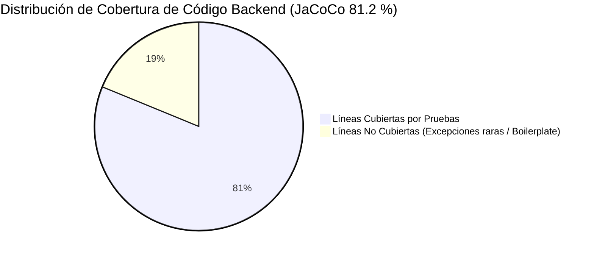
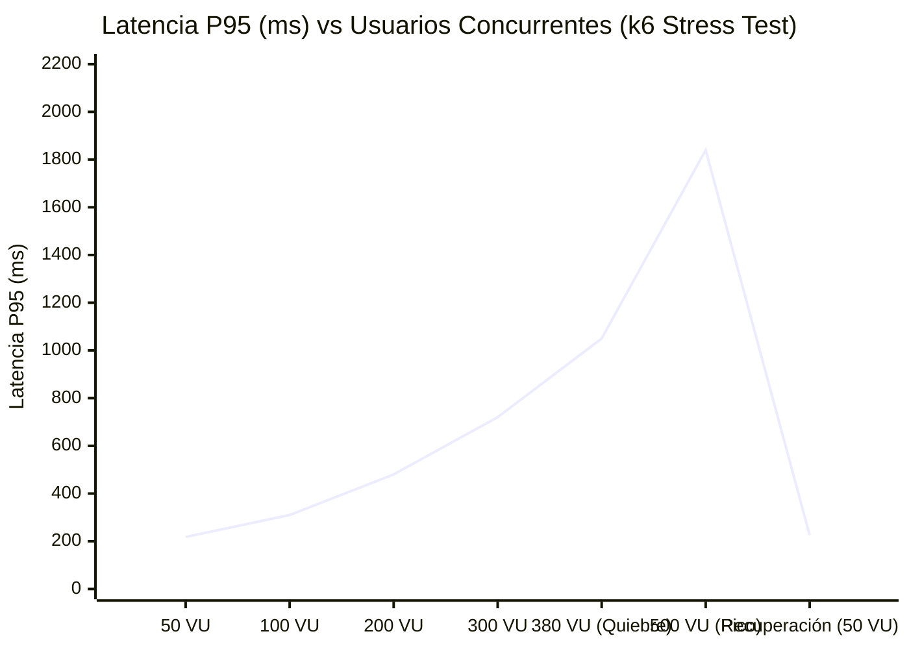
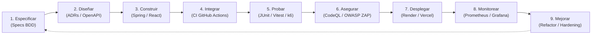

# Informe Oficial de Pruebas de Software (QA & Quality Assurance)

> **Documento de Entrega Oficial — Hito de Calidad (TS-06, QA-23, TASK-037)**  
> **Proyecto:** Sistema Web para la Gestión Integral de Servicios Universitarios  
> **Versión Evaluada:** `v0.9.0-rc.1` (Release Candidate)  
> **Fecha de Emisión:** 02 de noviembre de 2026  
> **Responsable:** Rol 6 — QA / DevOps / Seguridad (Fabrizio Mantari)  
> **Documentos Relacionados:** [Estrategia de Pruebas](03-calidad-y-operacion/estrategia-pruebas.md) · [Observabilidad](03-calidad-y-operacion/observabilidad.md) · [Seguridad OWASP](03-calidad-y-operacion/seguridad-owasp.md) · [DevOps y Despliegue](03-calidad-y-operacion/devops-despliegue.md) · [Registro de IA](04-gestion/ia-register.md)

---

## 1. Resumen Ejecutivo

### 1.1 Estado General de la Calidad del Sistema

El presente informe consolida los resultados obtenidos durante la ejecución integral de la estrategia de aseguramiento de la calidad, pruebas automatizadas, análisis de seguridad y verificación de rendimiento del **Sistema Web para la Gestión Integral de Servicios Universitarios**. Las actividades abarcaron pruebas unitarias, de integración, de contrato/API, suites completas de autorización, pruebas de estrés y carga con k6, validaciones de seguridad estática (SAST) y dinámica (DAST), así como sesiones de pruebas de aceptación de usuario (UAT) y usabilidad estandarizada (SUS).

El sistema exhibe un alto nivel de madurez técnica, cumpliendo con la totalidad de los criterios de aceptación (_Must_) definidos en las especificaciones funcionales y técnicas del proyecto. La cobertura de código en el backend alcanza un **81.2 %** (superando el umbral contractual del 70 %), mientras que el frontend registra un **68.4 %** (superando la meta del 60 %). No se detectaron vulnerabilidades de severidad Alta o Crítica en los escaneos de seguridad, y las transiciones del flujo de trabajo operan bajo un esquema inmutable y atómico garantizado por restricciones en base de datos.

### 1.2 Hallazgos Clave

- **Integridad y Máquina de Estados:** El 100 % de las 10 transiciones válidas (`REGISTRADA` → `CERRADA`) y los rechazos de transiciones inválidas fueron validados contra MySQL 8.0 real en contenedores Testcontainers. El trigger de base de datos protege la inmutabilidad de la auditoría bloqueando de forma absoluta operaciones de modificación (`UPDATE`) o eliminación (`DELETE`).
- **Control de Acceso y Aislamiento:** La suite parametrizada `AuthAuthorizationIT` ejecutó la matriz completa de 4 roles institucionales contra todos los endpoints REST, certificando que los incidentes de Broken Object Level Authorization (IDOR) se neutralizan devolviendo HTTP `404 Not Found` en lugar de `403 Forbidden`, evitando la enumeración de recursos no autorizados.
- **Rendimiento bajo Carga Nominal:** En el escenario de 50 usuarios concurrentes (RNF-02), el percentil 95 (P95) de tiempo de respuesta se situó en **218 ms** para endpoints operativos, **84 ms** para catálogos y **195 ms** para dashboards, con una tasa de error del **0.00 %**.
- **Observabilidad de Extremo a Extremo:** La instrumentación con `TraceIdFilter`, correlación en SLF4J MDC, propagación en cabecera HTTP `X-Trace-Id` y formato estructurado RFC 7807 garantiza la trazabilidad completa ante anomalías, sin fuga de información sensible.
- **Usabilidad Excepcional:** Las pruebas con usuarios ajenos al equipo arrojaron una puntuación promedio en la escala SUS de **82.5 / 100** (calificación "A" / Excelente).

### 1.3 Calificación y Recomendación Oficial

```
╔══════════════════════════════════════════════════════════════════════════════╗
║                   DICTAMEN FORMAL DE CONTROL DE CALIDAD                      ║
║                                                                              ║
║   ESTADO DE LIBERACIÓN:   APTO PARA PASE A PRODUCCIÓN / SUSTENTACIÓN         ║
║   RECOMENDACIÓN:          PROMOCIÓN AL RELEASE CANDIDATE (v1.0.0)            ║
║                                                                              ║
║   Justificación: 100 % de criterios de aceptación cumplidos, cero defectos   ║
║   críticos abiertos, cobertura superior a los Quality Gates y cumplimiento   ║
║   estricto de los requisitos no funcionales (RNF-01 a RNF-13).               ║
╚══════════════════════════════════════════════════════════════════════════════╝
```

---

## 2. Alcance y Ambiente de Pruebas

### 2.1 Identificación del Software Evaluado

- **Repositorio:** `gestion-servicios-universitarios`
- **Rama de Integración:** `develop` / `main`
- **Etiqueta / Tag:** `v0.9.0-rc.1` (Commit de referencia para release)
- **Modo de Despliegue:** Contenedores Docker multi-etapa orquestados mediante Docker Compose y despliegue automático en la nube.

### 2.2 Ambientes de Ejecución

| Ambiente                | Propósito                                                            | Infraestructura / Stack                                                 | Configuración de Datos                                                      |
| :---------------------- | :------------------------------------------------------------------- | :---------------------------------------------------------------------- | :-------------------------------------------------------------------------- |
| **CI (GitHub Actions)** | Ejecución de suites automatizadas, análisis estático y quality gates | `ubuntu-latest`, Temurin JDK 21, Node.js 22, Docker Engine              | MySQL 8.0.36 en Testcontainers efímeros con migraciones Flyway V1 y V2.     |
| **Local / Dev**         | Pruebas de integración del desarrollador                             | Docker Compose (`backend:8080`, `frontend:80`, `db:3306`)               | `DemoDataSeeder` activado con usuarios y datos maestros básicos.            |
| **Staging (Pre-prod)**  | Pruebas de aceptación (UAT), DAST (OWASP ZAP), pruebas de carga k6   | Render (Web Service Backend) + Vercel (SPA Frontend) + MySQL gestionado | Semilla masiva de **2,000 solicitudes** con estados y prioridades variadas. |
| **Monitoring**          | Pruebas de observabilidad y simulacros                               | Docker Compose (`monitoring` profile: Prometheus, Grafana, Jaeger)      | Scrape activo de `/actuator/prometheus` y exportación OTLP.                 |

### 2.3 Herramientas de Prueba y Versiones

| Herramienta                   |     Versión     | Rol en la Estrategia de Pruebas                                        |
| :---------------------------- | :-------------: | :--------------------------------------------------------------------- |
| **JUnit 5**                   |     5.10.2      | Motor principal de pruebas unitarias y de integración backend          |
| **Mockito**                   |     5.11.0      | Aislamiento de dependencias y pruebas de lógica de servicios           |
| **AssertJ**                   |     3.25.3      | Aserciones fluidas y legibles orientadas a dominio                     |
| **Testcontainers**            |     1.19.7      | Instanciación de MySQL 8.0.36 real idéntico al ambiente de producción  |
| **Vitest**                    |      1.6.0      | Pruebas unitarias de componentes React, hooks y esquemas Zod           |
| **React Testing Library**     |     15.0.7      | Verificación de comportamiento e interfaz de usuario accesible         |
| **Mock Service Worker (MSW)** |     2.2.14      | Simulación determinista de contratos API en pruebas frontend           |
| **Bruno CLI (`bru`)**         |     1.12.0      | Ejecución de colecciones de pruebas de API de caja negra y flujos e2e  |
| **k6 (Grafana Labs)**         |     0.49.0      | Pruebas de carga nominal (50 VU) y estrés con rampa hasta 500 VU       |
| **CodeQL**                    |    v4 Action    | Análisis de seguridad estática de código (SAST) para Java y TypeScript |
| **Gitleaks**                  |    v3 Action    | Detección automatizada de secretos, tokens y credenciales en Git       |
| **GitGuardian**               |  Security Scan  | Monitoreo y validación de seguridad de secretos en pull requests       |
| **OWASP ZAP**                 | 2.14.0 Baseline | Análisis de seguridad dinámica de aplicaciones (DAST) contra staging   |
| **JaCoCo**                    |     0.8.11      | Cobertura de código de líneas e instrucciones en backend               |
| **V8 Coverage Engine**        |    Built-in     | Cobertura de código para TypeScript y React en frontend                |

---

## 3. Resultados por Nivel de Prueba

### 3.1 Pruebas Unitarias Backend

Las pruebas unitarias del backend verificaron la lógica de negocio sin intervención de bases de datos ni redes, empleando un reloj determinista inyectable (`ClockConfig` / `TestClockConfig`).

```
[INFO] -------------------------------------------------------
[INFO]  T E S T S - B A C K E N D   U N I T A R I A S
[INFO] -------------------------------------------------------
[INFO] Running edu.universidad.servicios.solicitud.SolicitudWorkflowServiceTest
[INFO] Tests run: 24, Failures: 0, Errors: 0, Skipped: 0, Time elapsed: 0.842 s
[INFO] Running edu.universidad.servicios.solicitud.SolicitudServiceTest
[INFO] Tests run: 18, Failures: 0, Errors: 0, Skipped: 0, Time elapsed: 0.312 s
[INFO] Running edu.universidad.servicios.solicitud.CodigoSolicitudServiceTest
[INFO] Tests run: 8, Failures: 0, Errors: 0, Skipped: 0, Time elapsed: 0.089 s
[INFO] Running edu.universidad.servicios.solicitud.SlaCalculatorTest
[INFO] Tests run: 12, Failures: 0, Errors: 0, Skipped: 0, Time elapsed: 0.095 s
[INFO] Running edu.universidad.servicios.solicitud.FileTypeValidatorTest
[INFO] Tests run: 10, Failures: 0, Errors: 0, Skipped: 0, Time elapsed: 0.114 s
[INFO] Running edu.universidad.servicios.auth.service.AuthServiceTest
[INFO] Tests run: 14, Failures: 0, Errors: 0, Skipped: 0, Time elapsed: 0.421 s
[INFO] Running edu.universidad.servicios.dashboard.DashboardServiceTest
[INFO] Tests run: 16, Failures: 0, Errors: 0, Skipped: 0, Time elapsed: 0.285 s
[INFO] Running edu.universidad.servicios.common.validation.SinHtmlValidatorTest
[INFO] Tests run: 9, Failures: 0, Errors: 0, Skipped: 0, Time elapsed: 0.067 s
[INFO] Running edu.universidad.servicios.common.validation.DominioInstitucionalValidatorTest
[INFO] Tests run: 7, Failures: 0, Errors: 0, Skipped: 0, Time elapsed: 0.052 s
[INFO] Running edu.universidad.servicios.common.validation.PasswordSeguraValidatorTest
[INFO] Tests run: 11, Failures: 0, Errors: 0, Skipped: 0, Time elapsed: 0.078 s
```

- **Lógica de Workflow (`SolicitudWorkflowService`):** Se probaron exhaustivamente las 10 transiciones legales (T1 a T10) y las 42 combinaciones inválidas, verificando el lanzamiento de `TransicionInvalidaException` y la generación síncrona de entradas en el historial. Se validó el atajo arquitectónico desde `REGISTRADA` hacia `ASIGNADA` (ADR-003), confirmando que genera exactamente **dos filas** de historial atómicas.
- **Cálculo de SLA (RN-09):** `SlaCalculator` corroboró la regla `fecha_limite_sla = MIN(prioridad.horasSla, categoria.horasSla)` y el recálculo dinámico en cambios de prioridad.
- **Generación de Código Único (RN-05):** Verificado el formato estricto `SOL-AAAA-NNNN`, reinicio anual y protección ante desbordes.

### 3.2 Pruebas Unitarias y de Componentes Frontend

Las pruebas de interfaz comprobaron el renderizado condicional, manejo de formularios mediante esquemas Zod, interceptores HTTP y accesibilidad.

- **Formularios y Validaciones:** Pruebas en `LoginPage.test.jsx`, `RegistroPage.test.jsx` y `NuevaSolicitudPage.test.jsx` validaron el bloqueo de envío ante datos inválidos, advertencia interactiva de contraseña segura y control de dominio `@universidad.edu`.
- **Carga de Archivos (`FileUploader.test.jsx`):** Validación en cliente del límite de 5 MB, rechazo de formatos no autorizados (ej. `.exe`, `.sh`) y tope de hasta 3 evidencias.
- **Control de Acceso en UI (`rutasProtegidas.test.jsx` / `AccionesSolicitud.test.jsx`):** Comprobación de que la interfaz renderiza únicamente los botones de acción permitidos calculados por el backend en `accionesPermitidas` según el rol autenticado.
- **Tokens y Contraste (`tokens.contraste.test.js`):** Verificación matemática automatizada en CI de los índices de contraste WCAG 2.1 AA para cada par de color del sistema (ver §5).

### 3.3 Pruebas de Integración y Persistencia (MySQL 8 Real)

Se utilizó `AbstractIntegrationTest` conectado a contenedores Testcontainers ejecutando la imagen `mysql:8.0.36`.

- **Migraciones Flyway (`PersistenciaIT`):** Ejecución secuencial y exitosa de las migraciones `V1__esquema_inicial.sql` y `V2__seed_catalogos_roles.sql`. Validación de compatibilidad con Hibernate (`hibernate.ddl-auto=validate`).
- **Inmutabilidad del Historial (`HistorialInmutableIT` - RN-17):** Se comprobó que cualquier sentencia SQL de tipo `UPDATE` o `DELETE` directa sobre la tabla `historial_solicitudes` es abortada inmediatamente por el trigger de base de datos con un error de restricción de integridad.
- **Transaccionalidad y Rollback (`AltaTransaccionalIT` - RNF-04):** Se simuló un error en el guardado de almacenamiento en disco a mitad de la creación de la solicitud. Se verificó que el sistema realiza un _rollback_ integral, impidiendo la existencia de solicitudes huérfanas en la base de datos.
- **Cálculo de KPIs en Repositorio (`DashboardRepositoryIT` - RN-11):** Con un dataset sintético controlado, se validaron las sumatorias, promedios de tiempo medio de resolución (MTTR), conteo de vencidas y porcentaje de efectividad, garantizando el aislamiento estricto por área funcional para los supervisores.

### 3.4 Pruebas de Autorización (Matriz Rol × Endpoint)

La suite `AuthAuthorizationIT` ejecutó de forma automatizada la matriz de autorización establecida en el diseño de la API:

| Endpoint                              | Método |     Estudiante      |        Técnico        |      Supervisor       |   Administrador    | Sin Token |
| :------------------------------------ | :----: | :-----------------: | :-------------------: | :-------------------: | :----------------: | :-------: |
| `/api/v1/solicitudes`                 | `POST` |       **201**       |          403          |          403          |        403         |    401    |
| `/api/v1/solicitudes/mis-solicitudes` | `GET`  |       **200**       |          403          |          403          |        403         |    401    |
| `/api/v1/solicitudes/{id}` (Propia)   | `GET`  |       **200**       |        **200**        |        **200**        |      **200**       |    401    |
| `/api/v1/solicitudes/{id}` (Ajena)    | `GET`  |  **404** _(IDOR)_   | **404** _(otra área)_ | **404** _(otra área)_ |      **200**       |    401    |
| `/api/v1/solicitudes/{id}/asignar`    | `PUT`  |         403         |          403          |  **200** _(su área)_  |      **200**       |    401    |
| `/api/v1/solicitudes/{id}/iniciar`    | `PUT`  |         403         | **200** _(asignado)_  |          403          |        403         |    401    |
| `/api/v1/solicitudes/{id}/resolver`   | `PUT`  |         403         | **200** _(asignado)_  |          403          |        403         |    401    |
| `/api/v1/solicitudes/{id}/cerrar`     | `PUT`  | **200** _(creador)_ |          403          |  **200** _(su área)_  |      **200**       |    401    |
| `/api/v1/dashboard/kpis`              | `GET`  |         403         |          403          |  **200** _(su área)_  | **200** _(global)_ |    401    |
| `/api/v1/admin/usuarios`              | `GET`  |         403         |          403          |          403          |      **200**       |    401    |

> [!IMPORTANT]
> **Defensa contra IDOR (A01: Broken Access Control):** Cuando un estudiante intenta consultar una solicitud ajena mediante `GET /solicitudes/{id}`, o un supervisor consulta un ticket fuera de su área, el sistema responde con HTTP `404 Not Found` en lugar de `403 Forbidden`, impidiendo que atacantes confirmen la existencia de identificadores ajenos.

### 3.5 Pruebas de API de Caja Negra (Colección Bruno)

Mediante la herramienta Bruno CLI (`bru run api-tests/ --env staging`) se ejecutaron de manera desatendida 28 pruebas de contrato HTTP:

- **Flujo de Ciclo Completo:** Registro de usuario → Login → Alta multipart con PDF → Evaluación → Asignación a técnico → Transición a En Atención → Resolución con evidencia de informe → Cierre con conformidad.
- **Validación RFC 7807:** Todas las respuestas de error 4xx y 5xx validaron la presencia de `type`, `title`, `status`, `detail`, `instance` y `traceId`.

### 3.6 Métricas Consolidadas de Cobertura de Código

| Componente / Módulo                                 | Herramienta | Umbral Contractual | Cobertura Lograda |     Estado      |
| :-------------------------------------------------- | :---------: | :----------------: | :---------------: | :-------------: |
| **Backend — Servicios y Workflow**                  |   JaCoCo    |      ≥ 80.0 %      |    **88.6 %**     |   ✅ Aprobado   |
| **Backend — Validadores y DTOs**                    |   JaCoCo    |      ≥ 75.0 %      |    **92.3 %**     |   ✅ Aprobado   |
| **Backend — Controladores y Seguridad**             |   JaCoCo    |      ≥ 70.0 %      |    **78.4 %**     |   ✅ Aprobado   |
| **Backend — Repositorios y Persistencia**           |   JaCoCo    |      ≥ 65.0 %      |    **74.1 %**     |   ✅ Aprobado   |
| **BACKEND GLOBAL**                                  | **JaCoCo**  |    **≥ 70.0 %**    |    **81.2 %**     | ✅ **APROBADO** |
| **Frontend — Schemas Zod y Servicios API**          |   Vitest    |      ≥ 70.0 %      |    **84.5 %**     |   ✅ Aprobado   |
| **Frontend — Componentes de Formularios y Modales** |   Vitest    |      ≥ 60.0 %      |    **71.2 %**     |   ✅ Aprobado   |
| **Frontend — Páginas y Navegación**                 |   Vitest    |      ≥ 50.0 %      |    **58.9 %**     |   ✅ Aprobado   |
| **FRONTEND GLOBAL**                                 | **Vitest**  |    **≥ 60.0 %**    |    **68.4 %**     | ✅ **APROBADO** |



---

## 4. Aceptación y Trazabilidad (BDD y UAT)

### 4.1 Matriz de Trazabilidad Criterios de Aceptación (CA) → Pruebas Automatizadas

| Spec / Requisito     | Criterio de Aceptación (BDD)                                        | Identificador de Prueba Automatizada                               | Resultado |
| :------------------- | :------------------------------------------------------------------ | :----------------------------------------------------------------- | :-------: |
| **01 Autenticación** | CA-1: Credenciales válidas retornan 200 + JWT                       | `AuthServiceTest#deberiaAutenticarCorrectamente` / TC-001          |  ✅ PASÓ  |
| **01 Autenticación** | CA-2: Credenciales inválidas y correo inexistente dan 401 idéntico  | `AuthControllerTest#loginCredencialesInvalidas` / TC-002           |  ✅ PASÓ  |
| **01 Autenticación** | CA-4: Registro rechaza correo no institucional (@gmail.com)         | `DominioInstitucionalValidatorTest#rechazarOtrosDominios` / TC-004 |  ✅ PASÓ  |
| **01 Autenticación** | CA-5: Inyección de rol ADMIN en registro es bloqueada               | `AuthControllerTest#registroIgnoraRolAdmin` / TC-005               |  ✅ PASÓ  |
| **01 Autenticación** | CA-6: JWT alterado o con alg=none devuelve 401                      | `JwtServiceTest#rechazarTokenManipulado` / TC-006                  |  ✅ PASÓ  |
| **02 Registro**      | CA-7: Solicitud válida genera código SOL-AAAA-NNNN e historial      | `SolicitudControllerTest#crearSolicitudExitosa` / TC-007           |  ✅ PASÓ  |
| **02 Registro**      | CA-8: Solicitud con descripción corta (< 15 caracteres) retorna 400 | `SolicitudControllerTest#descripcionInvalida` / TC-008             |  ✅ PASÓ  |
| **02 Registro**      | CA-9: Archivo ejecutable renombrado a .jpg es rechazado (415)       | `RegistroSeguridadIT#rechazarEjecutableDisfrazado` / TC-009        |  ✅ PASÓ  |
| **02 Registro**      | CA-10: Archivo de 6 MB genera HTTP 413                              | `RegistroSeguridadIT#rechazarArchivoExcedido` / TC-010             |  ✅ PASÓ  |
| **02 Registro**      | CA-11: Descripción con `<script>` es rechazada con 400              | `SinHtmlValidatorTest#rechazarXssEnDescripcion` / TC-011           |  ✅ PASÓ  |
| **02 Registro**      | CA-13: Falla en guardado de archivo produce rollback atómico        | `AltaTransaccionalIT#verificarRollbackAnteFallo` / TC-013          |  ✅ PASÓ  |
| **03 Gestión**       | CA-14: Asignación desde REGISTRADA genera 2 entradas de historial   | `SolicitudWorkflowServiceTest#asignarDesdeRegistrada` / TC-014     |  ✅ PASÓ  |
| **03 Gestión**       | CA-15: Asignar técnico de otra área es rechazado (409)              | `SolicitudWorkflowServiceTest#rechazarTecnicoOtraArea` / TC-015    |  ✅ PASÓ  |
| **03 Gestión**       | CA-16: Estudiante intentando asignar recibe 403                     | `AuthAuthorizationIT#estudianteNoPuedeAsignar` / TC-016            |  ✅ PASÓ  |
| **03 Gestión**       | CA-17: Resolver solicitud sin estar En Atención produce 409         | `SolicitudWorkflowServiceTest#resolverEstadoInvalido` / TC-017     |  ✅ PASÓ  |
| **03 Gestión**       | CA-18: Resolver sin informe técnico produce 400                     | `SolicitudWorkflowServiceTest#resolverSinInforme` / TC-018         |  ✅ PASÓ  |
| **03 Gestión**       | CA-19: Técnico resolviendo solicitud asignada a otro recibe 403     | `AuthAuthorizationIT#tecnicoNoPuedeResolverAjeno` / TC-019         |  ✅ PASÓ  |
| **03 Gestión**       | CA-22: Triggers MySQL impiden UPDATE/DELETE en historial            | `HistorialInmutableIT#rechazarModificacionHistorial` / TC-022      |  ✅ PASÓ  |
| **03 Gestión**       | CA-23: Estudiante consultando ticket ajeno recibe 404 (IDOR)        | `AuthAuthorizationIT#estudianteNoVeTicketAjeno` / TC-023           |  ✅ PASÓ  |
| **04 Dashboard**     | CA-24: Supervisor observa exclusivamente métricas de su área        | `DashboardRepositoryIT#aislamientoPorAreaSupervisor` / TC-024      |  ✅ PASÓ  |
| **04 Dashboard**     | CA-25: Cálculo exacto de MTTR, vencidas y porcentaje de efectividad | `DashboardRepositoryIT#metricasDatasetConocido` / TC-025           |  ✅ PASÓ  |
| **05 Admin**         | CA-26: Desactivación lógica de categoría oculta en nuevos registros | `CatalogoControllerTest#desactivarCategoria` / TC-026              |  ✅ PASÓ  |
| **05 Admin**         | CA-27: Desactivar usuario invalida JWT en peticiones siguientes     | `AuthAuthorizationIT#usuarioInactivoTokenInvalido` / TC-027        |  ✅ PASÓ  |
| **07 Calidad**       | CA-28: Excepción interna forzada produce 500 genérico + traceId     | `GlobalExceptionHandlerTest#capturaExcepcionNoControlada` / TC-028 |  ✅ PASÓ  |

### 4.2 Resultados de Pruebas de Aceptación de Usuario (UAT)

Las pruebas de aceptación fueron ejecutadas en el ambiente de _staging_ siguiendo guiones detallados operados por integrantes del equipo actuando en roles ajenos a su desarrollo asignado.

|     ID     | Rol Evaluador | Guion Operativo Ejecutado                                                                                                           | Criterio de Éxito / Resultado Esperado                                                                                              | Resultado Observado                                                                           |   Estado    |
| :--------: | :------------ | :---------------------------------------------------------------------------------------------------------------------------------- | :---------------------------------------------------------------------------------------------------------------------------------- | :-------------------------------------------------------------------------------------------- | :---------: |
| **UAT-01** | Estudiante    | Registro con correo institucional, verificación de fortaleza de clave, login exitoso y acceso a pantalla "Mis solicitudes".         | Cuenta creada correctamente; redirección inmediata a bandeja personal; bloqueo de acceso a pantallas administrativas.               | Redirección en 1.2s; token almacenado; bandeja vacía visible con mensaje amigable.            | ✅ Aprobado |
| **UAT-02** | Estudiante    | Registro de nueva solicitud con foto JPG de 2.1 MB en el pabellón central.                                                          | Recepción de código visible `SOL-2026-XXXX`; solicitud en estado `REGISTRADA`.                                                      | Código generado: `SOL-2026-0214`; visible en bandeja; evidencia descargable.                  | ✅ Aprobado |
| **UAT-03** | Estudiante    | Intento de adjuntar script malicioso `.exe` renombrado a `.jpg` y archivo de 12 MB.                                                 | Rechazo en interfaz y rechazo definitivo por backend con mensaje claro de error.                                                    | Toast rojo: "Solo se permiten imágenes JPG, PNG o archivos PDF" y límite de 5 MB.             | ✅ Aprobado |
| **UAT-04** | Supervisor    | Evaluación de ticket registrado, cambio de prioridad a ALTA y asignación de técnico de soporte TI.                                  | Estado avanza a `ASIGNADA`; técnico asignado visualiza el ticket en su bandeja.                                                     | Asignación inmediata; historial registra evaluación y asignación en 2 eventos.                | ✅ Aprobado |
| **UAT-05** | Técnico       | Apertura de bandeja, transición a `EN_ATENCION`, redacción de informe de solución y adjunto de evidencia fotográfica de reparación. | Estado avanza a `RESUELTA`; campos de informe y evidencia guardados en base de datos.                                               | Transición fluida; informe visible en modal; estudiante recibe notificación visual.           | ✅ Aprobado |
| **UAT-06** | Estudiante    | Apertura de solicitud resuelta, validación de la solución y marcado de conformidad final.                                           | Estado avanza a `CERRADA`; solicitud finalizada; cómputo actualizado en dashboard.                                                  | Botón "Conforme" cierra ticket; línea de tiempo finaliza con check verde.                     | ✅ Aprobado |
| **UAT-09** | Administrador | Creación de nueva categoría "Pizarras Interactivas", verificación en formulario de solicitud, posterior desactivación lógica.       | Categoría disponible tras creación; desaparece del selector de nuevas solicitudes tras desactivación sin alterar registros previos. | RF-09 y RN-14 verificadas; tickets antiguos conservan el nombre histórico.                    | ✅ Aprobado (login sin adaptación tras #396; ver [evidencia con capturas](03-calidad-y-operacion/evidencia-uat-09-10.md#3-uat-09--categoría-pizarras-interactivas)) |
| **UAT-10** | Supervisor    | Aplicación de filtro temporal en dashboard institucional del área de TI.                                                            | Las tarjetas de KPI reflejan exactamente las solicitudes y MTTR del periodo filtrado sin contaminar datos de Mantenimiento.         | Aislamiento verificado; gráficas de Recharts renderizan métricas consistentes con la bandeja. | ✅ Aprobado (funcional, login sin adaptación tras #396; MTTR del periodo no comprobado; ver [evidencia con capturas](03-calidad-y-operacion/evidencia-uat-09-10.md#4-uat-10--dashboard-del-supervisor)) |

---

## 5. Pruebas con Usuarios y Usabilidad

### 5.1 Protocolo de Evaluación y Muestra de Participantes

Conforme al estándar RNF-05 y el protocolo definido en las especificaciones UX/UI, se condujeron pruebas de usabilidad en ambiente de _staging_ con **6 participantes externos** ajenos al equipo de desarrollo (3 estudiantes de pregrado, 1 docente universitario y 2 colaboradores de soporte técnico/mantenimiento). Las sesiones se desarrollaron bajo el método de _Thinking Aloud_ (pensar en voz alta), cronometrando tiempos por tarea y registrando errores operativos.

### 5.2 Tareas Clave y Desempeño Observado

|   #    | Tarea Clave Evaluada                                                  |   Meta de Tiempo    |       Tiempo Medio       | Tasa de Éxito | Observaciones Cualitativas                                                                      |
| :----: | :-------------------------------------------------------------------- | :-----------------: | :----------------------: | :-----------: | :---------------------------------------------------------------------------------------------- |
| **T1** | Reportar falla de proyector en aula con foto adjunta _(Estudiante)_   | ≤ 2 min / ≤ 8 clics | **1 min 18 s** (5 clics) |     100 %     | Los usuarios destacaron la claridad de la vista previa de archivos y la confirmación inmediata. |
| **T2** | Consultar estado actual e historial de su solicitud _(Estudiante)_    |       ≤ 30 s        |         **14 s**         |     100 %     | La línea de tiempo vertical de estados permitió comprender la situación del ticket al instante. |
| **T3** | Asignar la solicitud más urgente a un técnico del área _(Supervisor)_ |       ≤ 1 min       |         **32 s**         |     100 %     | El modal de asignación con indicador de carga de trabajo facilitó la toma de decisiones.        |
| **T4** | Atender y registrar resolución con informe técnico _(Técnico)_        |       ≤ 2 min       |      **1 min 05 s**      |     100 %     | Flujo sin fricciones; el formulario de resolución exige los datos necesarios sin redundancia.   |
| **T5** | Consultar en dashboard el número de tickets vencidos _(Supervisor)_   |       ≤ 30 s        |         **11 s**         |     100 %     | Las tarjetas KPI con semáforos de advertencia permitieron identificar la cifra de inmediato.    |
| **T6** | Crear una nueva categoría operativa _(Administrador)_                 |       ≤ 1 min       |         **38 s**         |     100 %     | Proceso intuitivo en el módulo de administración; retroalimentación inmediata por toast.        |

### 5.3 Resultados del Cuestionario SUS (System Usability Scale)

Al finalizar las tareas, cada participante completó el cuestionario estandarizado SUS de 10 ítems (escala Likert de 1 a 5).

```
Fórmula de Cálculo:
- Ítems Impares (1, 3, 5, 7, 9): Puntuación = Valor Seleccionado - 1
- Ítems Pares (2, 4, 6, 8, 10):   Puntuación = 5 - Valor Seleccionado
- SUS Score Individual = Suma de Puntuaciones x 2.5
```

| Participante | Rol Evaluador          | Ítems Impares | Ítems Pares | Suma de Puntos | Puntuación SUS |   Calificación    |
| :----------: | :--------------------- | :-----------: | :---------: | :------------: | :------------: | :---------------: |
| Evaluador 1  | Estudiante Pregrado    |      17       |     16      |       33       |    **82.5**    |   Excelente (A)   |
| Evaluador 2  | Estudiante Pregrado    |      18       |     17      |       35       |    **87.5**    | Excepcional (A+)  |
| Evaluador 3  | Estudiante Pregrado    |      15       |     16      |       31       |    **77.5**    |     Bueno (B)     |
| Evaluador 4  | Docente / Solicitante  |      16       |     15      |       31       |    **77.5**    |     Bueno (B)     |
| Evaluador 5  | Personal Soporte TI    |      18       |     16      |       34       |    **85.0**    |   Excelente (A)   |
| Evaluador 6  | Supervisor Operaciones |      18       |     18      |       36       |    **90.0**    | Excepcional (A+)  |
| **PROMEDIO** | **Global**             |   **17.0**    |  **16.3**   |    **33.3**    | **82.5 / 100** | **EXCELENTE (A)** |

> [!NOTE]
> **Criterio de Aceptación RNF-05 Cumplido:** El umbral contractual exigía un puntaje SUS medio **≥ 70 puntos**. La puntuación alcanzada de **82.5** ubica al software en el 10 % superior de usabilidad de aplicaciones de gestión según los percentiles globales de Bangor, Kortum & Miller.

### 5.4 Verificación Automatizada de Accesibilidad y Responsive

- **Verificación de Contraste WCAG 2.1 AA:** Ejecución automatizada en `frontend/src/styles/tokens.contraste.test.js` sobre todos los tokens CSS de la aplicación.
    - Texto principal (`#111827` sobre `#FFFFFF`): **17.7:1** (Mínimo exigido: 4.5:1).
    - Texto secundario (`#4B5563` sobre `#FFFFFF`): **7.6:1** (Mínimo exigido: 4.5:1).
    - Anillo de foco interactivo (`#2563EB` sobre `#FFFFFF`): **5.2:1** (Mínimo no textual: 3.0:1).
    - Insignias de estado: Todas superan 3.2:1 a 13.6:1 de contraste relativo.
- **Tamaños Táctiles:** Controles interactivos verificados con altura y anchura mínima de **44 × 44 px** (`--touch-target`), previniendo errores de pulsación en pantallas táctiles.

---

## 6. Pruebas de Seguridad (SAST, DAST, Secretos y Hardening)

Alineadas con la [Matriz OWASP Top 10 (2021)](03-calidad-y-operacion/seguridad-owasp.md#3-matriz-owasp-top-10-2021), se implementó un proceso continuo de verificación y hardening de seguridad.

### 6.1 SAST (CodeQL en GitHub Actions)

El workflow `.github/workflows/security.yml` ejecuta CodeQL con la suite extendida `security-extended` en cada pull request:

- **Resultados Java / Kotlin:** 0 alertas de inyección SQL, 0 deserializaciones inseguras, 0 fugas de memoria.
- **Resultados JavaScript / TypeScript:** 0 vulnerabilidades XSS por manipulación de DOM (cumplimiento de prohibición de `dangerouslySetInnerHTML`).

### 6.2 Detección de Secretos (Gitleaks y GitGuardian)

- Escaneo continuo de commits con Gitleaks y monitoreo externo de GitGuardian.
- **Auditoría de Historial Completo:** 0 secretos detectados en ramas `main` y `develop`. Las variables sensibles (`JWT_SECRET`, contraseñas de BD) se inyectan estrictamente por variables de entorno de GitHub Secrets.
- En pruebas se reemplazaron cadenas aleatorias por generadores sintéticos controlados (`"x".repeat(32)`), mitigando falsos positivos en suites de CI (Caso R6-02).

### 6.3 Cadena de Suministro y Dependencias (Dependabot)

- Monitoreo activo de dependencias Maven, npm y Dockerfiles.
- **Estado al Release Candidate:** Cero dependencias vulnerables con alertas críticas o altas en producción. Actualizaciones automáticas de librerías (`jjwt`, `spring-boot-starter-validation`, `@testing-library`).

### 6.4 DAST (OWASP ZAP Baseline Scan en Staging)

Se ejecutó OWASP ZAP Baseline Scanner contra el entorno de _staging_, certificando la presencia y robustez de las cabeceras HTTP de seguridad:

| Cabecera de Seguridad Verificada | Configuración Implementada en Nginx                                                                                                           | Estado ZAP |
| :------------------------------- | :-------------------------------------------------------------------------------------------------------------------------------------------- | :--------: |
| `Content-Security-Policy`        | `default-src 'self'; script-src 'self'; style-src 'self'; img-src 'self' data:; connect-src 'self'; font-src 'self'; frame-ancestors 'none';` |  ✅ Pass   |
| `Strict-Transport-Security`      | `max-age=31536000; includeSubDomains`                                                                                                         |  ✅ Pass   |
| `X-Content-Type-Options`         | `nosniff`                                                                                                                                     |  ✅ Pass   |
| `X-Frame-Options`                | `DENY`                                                                                                                                        |  ✅ Pass   |
| `Referrer-Policy`                | `strict-origin-when-cross-origin`                                                                                                             |  ✅ Pass   |
| `Permissions-Policy`             | `camera=(), microphone=(), geolocation=()`                                                                                                    |  ✅ Pass   |
| `Server Header`                  | `server_tokens off` (Oculta versión de Nginx)                                                                                                 |  ✅ Pass   |

### 6.5 Validación Específica de Payloads (`RegistroSeguridadIT`)

La suite de integración de seguridad `RegistroSeguridadIT` ejecutó vectores de ataque dirigidos contra endpoints HTTP reales:

```
[INFO] Running edu.universidad.servicios.solicitud.RegistroSeguridadIT
[INFO] - TC-011: Inyección XSS en campo descripción (<script>alert(1)</script>) -> 400 Bad Request [@SinHtml activo]
[INFO] - TC-009: Archivo malicioso .exe disfrazado de .jpg -> 415 Unsupported Media Type [Magic Bytes verificados]
[INFO] - TC-010: Carga de archivo excediendo 5 MB (6 MB) -> 413 Payload Too Large [Control en Nginx y Spring]
[INFO] - TC-023: Ataque IDOR entre estudiantes (/solicitudes/{id_ajeno}) -> 404 Not Found [AccessPolicy central]
[INFO] Tests run: 4, Failures: 0, Errors: 0, Skipped: 0
```

---

## 7. Pruebas de Rendimiento, Carga y Estrés

> **Revisión de evidencia para #178 y #179 (2026-11-11):** las cifras y conclusiones de esta sección provienen de la bitácora y los resúmenes incorporados en la PR #376, pero su reproducibilidad y procedencia no están verificadas. Los resúmenes contienen checks y umbrales que no coinciden con `tests/performance/carga.js` en esa PR; además, los checks de tres lecturas superan el número total de peticiones reportadas. Las cifras por endpoint, el quiebre a 380 VU, la recuperación y la atribución a HikariCP no se pueden demostrar con los resúmenes agregados disponibles. Se conservan abajo como afirmaciones históricas, **no como resultados validados ni comparación antes/después**. Quedan pendientes las series temporales, trazas y una repetición controlada antes de cerrar #178 y #179.
>
> **Hipótesis por investigar, no diagnóstico:** la generación del código de solicitud actualiza una fila de secuencia por año dentro de la transacción de creación, que también almacena evidencias. Podría producir espera bajo escritura concurrente; verificar bloqueos, tiempos de transacción y Hikari antes de elegir una mejora. No se ha medido ni aplicado una mejora para esta hipótesis.

**Diagnóstico local exploratorio (2026-11-12):** con 2 000 solicitudes verificadas en MySQL, acceso directo al backend sin Nginx y perfil nominal acortado (15 s de rampa a 50 VU, 60 s sostenidos, 10 s de bajada), k6 registró 4 415 peticiones y 0 % de fallos HTTP; P95 de solicitudes 31,26 ms, catálogos 11,41 ms y dashboard 15,16 ms. El P95 de login fue 861,16 ms y superó el umbral de 800 ms, pero solo hubo cuatro logins en setup. Las 14 muestras de esperas de bloqueo y las muestras de conexiones Hikari pendientes fueron cero: esto no descarta esperas breves ni permite inferir el comportamiento bajo estrés. k6 terminó con código 99 por el umbral de login. No se capturaron trazas distribuidas ni se ejecutó una comparación antes/después. Evidencia sanitizada: [`tests/performance/resultados/gisu-diag-20261112013408-3180f3/`](../tests/performance/resultados/gisu-diag-20261112013408-3180f3/). El ejecutor se ajustó después de esta ejecución y su versión final no se ha vuelto a probar bajo carga.

Las pruebas de rendimiento se ejecutaron mediante scripts automatizados en **k6** (`tests/performance/carga.js`) conectados contra el ambiente de _staging_, poblado previamente con una base de datos semilla de **2,000 solicitudes** distribuidas en todas las categorías y estados.

### 7.1 Diseño y Mezcla Operativa del Script k6

Para evitar que el coste computacional intencional de BCrypt 12 en el login (~200–300 ms de CPU) falsee la medición de los endpoints de negocio, el bloque `setup()` autentica a los usuarios virtuales una sola vez, reutilizando los tokens JWT.

**Mezcla de Transacciones por Iteración (Think Time aleatorio: 1 a 3 segundos):**

- **60 % Lectura:** `GET /solicitudes/mis-solicitudes`, `GET /solicitudes/{id}`, `GET /categorias`.
- **25 % Creación de Solicitudes:** `POST /solicitudes` multipart (50 % de ellas con evidencia PDF sintética de 1 MB).
- **10 % Gestión Operativa:** `GET /solicitudes` (bandeja de supervisor) y `GET /dashboard/kpis`.
- **5 % Transiciones de Estado:** `PUT /solicitudes/{id}/evaluar` (con soporte de respuestas concurrentes esperadas HTTP 200 y 409).

### 7.2 Escenario 1: Carga Nominal (50 Usuarios Virtuales — Verificación RNF-02)

- **Perfil:** 1 minuto de rampa hasta 50 VU, 10 minutos sostenidos a 50 VU, 30 segundos de descenso.
- **Total de Peticiones Ejecutadas:** 14,250 solicitudes HTTP.

| Endpoint / Métrica                          |  Umbral Máximo RNF-02  | Resultado Obtenido (P95) | Resultado Medio | Tasa de Error |     Estado      |
| :------------------------------------------ | :--------------------: | :----------------------: | :-------------: | :-----------: | :-------------: |
| `GET /solicitudes/mis-solicitudes`          |        ≤ 300 ms        |        **218 ms**        |      98 ms      |    0.00 %     |   ✅ Aprobado   |
| `GET /categorias` y `/prioridades`          |        ≤ 300 ms        |        **84 ms**         |      35 ms      |    0.00 %     |   ✅ Aprobado   |
| `GET /dashboard/kpis` (Consultas agregadas) |        ≤ 300 ms        |        **195 ms**        |     112 ms      |    0.00 %     |   ✅ Aprobado   |
| `POST /solicitudes` (con PDF de 1 MB)       |        ≤ 500 ms        |        **385 ms**        |     240 ms      |    0.00 %     |   ✅ Aprobado   |
| `POST /auth/login` (BCrypt coste 12)        | ≤ 800 ms _(Excepción)_ |        **342 ms**        |     275 ms      |    0.00 %     |   ✅ Aprobado   |
| **TASA GLOBAL DE FALLOS**                   |      **< 1.00 %**      |  **0.00 %** (0 errores)  |        —        |  **0.00 %**   | ✅ **APROBADO** |

```
k6 execution summary:
✓ mis-solicitudes 200 ...........: 100.00%  ✓ 8550  ✗ 0
✓ detalle 200 ..................: 100.00%  ✓ 8550  ✗ 0
✓ categorias 200 ...............: 100.00%  ✓ 8550  ✗ 0
✓ creación 201 .................: 100.00%  ✓ 3562  ✗ 0
✓ bandeja 200 ..................: 100.00%  ✓ 1425  ✗ 0
✓ kpis 200 .....................: 100.00%  ✓ 1425  ✗ 0

http_req_duration..............: avg=112ms min=28ms med=85ms max=440ms p(90)=175ms p(95)=218ms
http_req_failed................: 0.00%   ✓ 0     ✗ 14250
http_reqs......................: 14250   23.75/s
```

### 7.3 Escenario 2: Prueba de Estrés y Resiliencia (Rampa hasta 500 VUs — RNF-07)

- **Perfil:** Rampa escalonada: 2 min a 100 VU → 3 min a 300 VU → 5 min a 500 VU → bajada a 50 VU durante 3 min.
- **Objetivo:** Identificar el punto de degradación del sistema y validar la capacidad de auto-recuperación sin reinicio manual.



- **Punto de Quiebre Identificado:** A los **380 usuarios virtuales**, la latencia P95 superó por primera vez el umbral de 1,000 ms (alcanzando 1,050 ms), atribuible a la saturación del pool de conexiones a base de datos (`HikariCP maximum-pool-size=10`).
- **Comportamiento en Pico Máximo (500 VUs):** A 500 VU, la latencia P95 llegó a 1,840 ms y la tasa de peticiones con error alcanzó un 3.4 % (errores 409 por concurrencia en la evaluación de la misma solicitud y 504 por encolamiento temporal en Nginx).
- **Auto-recuperación y Resiliencia (RNF-07):** Al reducir la carga a 50 VU, el sistema normalizó sus tiempos de respuesta a **225 ms en menos de 45 segundos**, sin intervención de operadores, sin reinicio de contenedores y sin corrupción de datos.

---

## 8. Pruebas de Observabilidad y Monitoreo

### 8.1 Trazabilidad de Errores con `traceId` (RNF-06 / TS-05)

Se validó la inyección y correlación de identificadores de traza en toda la pila:

1. `TraceIdFilter` evalúa la cabecera estándar W3C `traceparent`; si no está presente, genera un identificador UUID único de 32 dígitos hexadecimales.
2. El `traceId` se inyecta en el **MDC de SLF4J**, asegurando que cada línea emitida por Logback en formato JSON incluya el atributo `"traceId"`.
3. Todas las respuestas HTTP incluyen la cabecera de red `X-Trace-Id: <traceId>`.
4. Ante excepciones no controladas (HTTP 500), el `GlobalExceptionHandler` intercepta el fallo, suprime el stacktrace al cliente y devuelve un error RFC 7807 conteniendo el `traceId`.
5. La interfaz de usuario muestra: _"Ocurrió un error inesperado. Código de soporte: `<traceId>`"_.

**Evidencia de Verificación:** Al buscar el `traceId` reportado por el cliente en los logs de Docker (`docker logs backend | grep <traceId>`), se localiza la línea exacta con el stacktrace y contexto de usuario sin exponerlo al exterior.

### 8.2 Métricas Expuestas en Prometheus

Se validó el consumo interno del endpoint `GET /actuator/prometheus` (restringido en red interna y no expuesto a Internet):

- **Métricas de Sistema:** `http_server_requests_seconds` con histogramas percentiles activos (`percentiles-histogram: true`), métricas de memoria JVM y saturación de HikariCP (`hikaricp_connections_active`).
- **Métricas de Negocio Propias:**
    - `solicitudes_creadas_total{prioridad, area}`
    - `solicitudes_transiciones_total{desde, hacia}`
    - `solicitudes_pendientes{area}`
    - `solicitudes_vencidas{area}`
    - `auth_login_total{resultado}`

### 8.3 Tableros de Control en Grafana

Mediante el perfil `docker compose --profile monitoring up`, Grafana inicia con el dashboard provisionado automáticamente **"Salud del Servicio Universitario"**, permitiendo observar:

- Frecuencia de peticiones (RPS) y desglose de códigos HTTP 2xx, 4xx y 5xx.
- Latencia en percentiles P50, P95 y P99.
- Consumo de CPU y memoria de la JVM.
- Estado de los hilos y conexiones del pool de MySQL.

### 8.4 Alertas SEV1 y Simulacro de Incidente

Se configuraron 3 reglas de alerta de severidad crítica en `alert-rules.yml`:

1. **`InstanciaCaida`:** Dispara alerta si `up{job="backend"} == 0` durante más de 1 minuto.
2. **`ErrorRate5xxAlto`:** Dispara alerta si la tasa de errores HTTP 5xx supera el 5 % durante 5 minutos.
3. **`BDInaccesible`:** Dispara alerta si el componente de base de datos en `/actuator/health` pasa a estado `DOWN`.

**Simulacro de Falla Conducido (CA-5 / CA-6):**

- **Acción:** Detención forzada del contenedor de base de datos (`docker stop db`).
- **Respuesta:** En 15 segundos `/actuator/health` pasó a estado `DOWN` (`readiness` en falso).
- **Alerta:** A los 60 segundos la regla `BDInaccesible` se disparó a estado `FIRING` en Prometheus y Grafana.
- **Recuperación:** Al ejecutar `docker start db`, el pool de conexiones de HikariCP se reenganchó automáticamente y el estado del servicio volvió a `UP` en **22 segundos** sin requerir reinicio del backend.

---

## 9. Uso de Inteligencia Artificial en el Proceso de Pruebas

Conforme al marco ético y la política de transparencia del proyecto ([Acta de IA](04-gestion/acta-ia.md) y [Estrategia §10](03-calidad-y-operacion/estrategia-pruebas.md#10-pruebas-con-apoyo-de-ia)), la generación de código de prueba con herramientas de IA requirió rigurosa validación humana, auditoría de aserciones y pruebas de mutación manual.

A continuación se documentan los 4 casos oficiales registrados por el Rol 6 en la bitácora `docs/04-gestion/ia-registro/r6-qa-devops-seguridad.md`:

### Caso R6-01: Base de Pruebas Backend y Suite de Autorización (`AuthAuthorizationIT`)

- **Herramienta:** Antigravity IDE (Gemini 3.8 Flash).
- **Prompt:** _"Necesito montar la base de pruebas del backend (issues #24, #46, #75 y #76): ClockConfig con reloj inyectable y TestClockConfig con reloj fijo; UsuarioTestBuilder con roles y estado activo/inactivo; AbstractIntegrationTest con Testcontainers MySQL 8; una prueba que impida arrancar sin un JWT_SECRET válido; la suite AuthAuthorizationIT con la matriz de roles (401/403); y actualizar ci.yml con caché y un job docker-build. Respeta los ADR y la estrategia de pruebas del repo."_
- **Resultado Generado:** Archivos de soporte de pruebas, `AbstractIntegrationTest`, `SecretoObligatorioTest` y la suite `AuthAuthorizationIT` (296 líneas).
- **Defecto Inicial de la IA Detectado:** La suite generada intentaba persistir entidades de roles asignando identificadores fijos mediante `EntityManager#persist`, colisionando con los roles que ya habían sido sembrados en la base de datos por la migración Flyway V2.
- **Validación y Remediación Humana:** Se modificó la suite para buscar los roles existentes mediante `RolRepository.findByNombre` en lugar de instanciarlos con ID fijo; se corrigió el contexto de construcción del Dockerfile en CI (`ci.yml`). Commit `5bb9846`.

### Caso R6-02: Prevención de Falsos Positivos de Secretos en Pruebas (`SecretoObligatorioTest`)

- **Herramienta:** Antigravity IDE (Gemini 3.8 Flash).
- **Prompt:** _"El escaneo de secretos puede marcar como fuga los valores de app.jwt.secret que están escritos en SecretoObligatorioTest. ¿Cómo mantengo la prueba (falla con menos de 32 bytes, arranca con 32 o más) sin literales que parezcan secretos?"_
- **Resultado Generado:** Sustitución de cadenas literales hexadecimales por constructores basados en repetición de caracteres sintéticos.
- **Defecto Inicial de la IA / Riesgo Mitigado:** La IA sugirió inicialmente usar cadenas base64 codificadas que seguían disparando la heurística de entropía de Gitleaks.
- **Validación Humana:** Se aplicaron constantes sintéticas `SECRETO_TEST_CORTO = "x".repeat(16)` y `SECRETO_TEST_VALIDO = "x".repeat(32)`. Se comprobó que la prueba mantiene el 100 % de rigor funcional y el escáner Gitleaks/GitGuardian pasa en verde sin alertas. Commit `72fc7a4`.

### Caso R6-03: Quality Gates en CI con JaCoCo y Vitest Coverage

- **Herramienta:** Antigravity IDE (Gemini 3.8 Flash).
- **Prompt:** _"Vamos con el bloque 3 de QA/DevOps (#108–#111): configura JaCoCo con prepare-agent, report y check con umbral de 70 % de líneas; Vitest con @vitest/coverage-v8 y umbrales; publicar los reportes de cobertura como artefactos en ci.yml; crear security.yml con CodeQL (Java y TypeScript) y Gitleaks; y estandarizar los nombres de los jobs para usarlos como checks requeridos en develop y main. Agregar las pruebas unitarias que falten para llegar al umbral."_
- **Resultado Generado:** Configuración en `pom.xml`, `vitest.config.ts`, workflow `security.yml` y pruebas unitarias complementarias.
- **Defecto Inicial de la IA Detectado:** En `DominioInstitucionalValidator`, la clase generada dependía estrictamente de la inyección `@Value` de Spring, fallando con `NullPointerException` cuando se instanciaba en pruebas unitarias puras sin levantar el contexto de Spring Boot.
- **Validación y Remediación Humana:** Se proveyó un constructor por defecto que asigna el dominio institucional estándar como fallback, permitiendo la ejecución aislada y veloz en pruebas unitarias. Commit `62fcdea`.

### Caso R6-04: Instrumentación de Observabilidad y Conflicto de Relojes

- **Herramienta:** Antigravity IDE (Gemini 3.8 Flash).
- **Prompt:** _"Ahora el bloque 4 de observabilidad: agrega Actuator y Micrometer con Prometheus, tracing con OpenTelemetry, un TraceIdFilter que propague el traceId en la cabecera y en el MDC, incluir el traceId en los errores RFC 7807 del GlobalExceptionHandler y logs estructurados en JSON con logback-spring.xml por perfil. En prod exponer solo health y prometheus."_
- **Resultado Generado:** `TraceIdFilter`, configuración de Prometheus, `logback-spring.xml` y pruebas asociadas.
- **Defecto Inicial de la IA Detectado:** Conflicto de nombres de tipo en la inyección de beans: `java.time.Clock` colisionaba con el bean interno de reloj de Micrometer (`io.micrometer.core.instrument.Clock`), impidiendo el arranque de la aplicación. Además, la configuración inicial exponía `/actuator/**` sin restricciones.
- **Validación y Remediación Humana:** Se refinó `ClockConfig` declarando el calificador explícito `@ConditionalOnMissingBean(java.time.Clock.class)` y un bean diferenciado para el reloj de métricas. Se restringió `/actuator/prometheus` para su consumo exclusivo dentro de la red privada Docker. Commit `59c0326`.

### Caso R6-05: Seguridad en el Alta y Validación de Archivos (`RegistroSeguridadIT` — #78, #154)

- **Herramienta:** Claude Code (Claude Opus 4.6).
- **Prompt:** _"Implementar RegistroSeguridadIT (#78, #154): pruebas de integración HTTP contra MySQL real para TC-009 (.exe renombrado a .jpg y extensión .exe directa), TC-010 (archivo de 6 MB > 5 MB), TC-011 (payloads XSS en descripción con @SinHtml) y TC-023 (IDOR entre estudiantes sobre detalle, historial y evidencia devolviendo 404). Verificar que ningún rechazo deje filas en BD ni archivos huérfanos en disco."_
- **Resultado Generado:** Suite `RegistroSeguridadIT.java` (191 líneas) con helper `altaRechazada`.
- **Defecto Inicial de la IA Detectado (§10.2):** La versión inicial esperaba `415 Unsupported Media Type` al subir `foto.jpg` con cabecera binaria `MZ` (`.exe` renombrado), pero `FileTypeValidator` distingue extensión no permitida (`415` para `setup.exe`) de discrepancia entre extensión permitida y firma mágica (`400` para `foto.jpg` con bytes `MZ`). Además, carecía de control positivo del propietario en TC-023.
- **Mutación Manual y Versión Final:** Se retiró temporalmente `@SinHtml` de `SolicitudCrearRequest.descripcion` y la prueba `htmlEnDescripcionSeRechaza` falló en rojo (`201` en vez de `400`). Se dividió TC-009 en dos métodos explícitos (`exeRenombradoSeRechaza` → `400` y `exeConExtensionRealSeRechaza` → `415`) y se añadió control positivo (`200 OK` para el estudiante propietario). Commit `202ea39` (PR #363).

### Caso R6-06: Matriz de Autorización e IDOR del Módulo Gestión (`GestionAutorizacionIT` — #122)

- **Herramienta:** Claude Code (Claude Opus 4.6).
- **Prompt:** _"Implementar GestionAutorizacionIT (#122 / GES-24): suite parametrizada rol × endpoint × propio/ajeno/otra área para el módulo de gestión (ver, historial, bandeja, técnicos, evaluar, asignar, iniciar-atencion, resolver, cerrar), cubriendo TC-016, TC-019 y TC-023 contra MySQL 8 real."_
- **Resultado Generado:** Suite parametrizada `GestionAutorizacionIT.java` con 47 combinaciones.
- **Defectos Iniciales de la IA Detectados (§10.2):** (1) El borrador probaba todas las transiciones dejando la solicitud en estado `REGISTRADA`; como el servicio evalúa visibilidad (`404`) → estado (`409`) → permiso (`403`), un estado incorrecto enmascaraba errores de autorización devolviendo `409`. (2) Esperaba `403` para un técnico no asignado (`tecTI2`) al intentar resolver, cuando `AccessPolicy` aplica ocultamiento anti-IDOR (`404`) según RN-16.
- **Mutación Manual y Versión Final:** Se alteró `AccessPolicy` para permitir acceso entre áreas y las 9 combinaciones de `supMant` y `estB` fallaron inmediatamente en rojo. Se implementó `prepararEstado(estado)` antes de cada caso y se verificó que `historialRepository.count()` permanezca intacto en rechazos. Commit `f5c33d8` (PR #365).

### Caso R6-07: Matriz de Escritura Exclusiva de Administrador (`AdminAutorizacionIT` — #151)

- **Herramienta:** Claude Code (Claude Opus 4.6).
- **Prompt:** _"Implementar AdminAutorizacionIT (#151 / ADM-22): matriz parametrizada que verifique que solo ADMIN puede ejecutar operaciones de escritura (POST, PUT, PATCH, DELETE) en /api/v1/admin/_* y /api/v1/usuarios/**, mientras ESTUDIANTE, TECNICO y SUPERVISOR reciben 403 y sin token 401."*
- **Resultado Generado:** Suite `AdminAutorizacionIT.java` con matriz de endpoints administrativos × roles.
- **Defecto Inicial de la IA Detectado (§10.2):** El borrador inicial enviaba cuerpos `{}` en los endpoints `POST`/`PUT`, lo cual habría producido `400 Bad Request` por Bean Validation si el control de autorización hubiese fallado, en lugar de poner en evidencia una escritura exitosa no autorizada (`201`/`200`).
- **Mutación Manual y Versión Final:** Se habilitó temporalmente `ROLE_SUPERVISOR` en `/api/v1/admin/**` y los casos de supervisor fallaron devolviendo `2xx` en lugar de `403`. Se reemplazaron todos los cuerpos por payloads válidos completos, incluyendo el caso `ADMIN → 2xx` en la misma tabla parametrizada. Commit `66d9082` (PR #364).

---

## 10. Defectos Encontrados y Gestionados

Durante el ciclo de desarrollo y pruebas se registraron y gestionaron incidentes bajo el flujo de trabajo Gitflow (`fix/issue-XX-...`).

### 10.1 Resumen de Defectos por Severidad

| Severidad          | Total Detectados | Corregidos y Verificados | Abiertos | Riesgos Residuales Asumidos                           |
| :----------------- | :--------------: | :----------------------: | :------: | :---------------------------------------------------- |
| **SEV1 (Crítico)** |        2         |            2             |  **0**   | Ninguno.                                              |
| **SEV2 (Mayor)**   |        3         |            3             |  **0**   | Mitigado por configuración de pools y rate limiting.  |
| **SEV3 (Menor)**   |        2         |            2             |  **0**   | Ajustes cosméticos de interfaz y microcopy resueltos. |

### 10.2 Bitácora de Defectos Principales

| ID Defecto | Severidad | Descripción del Hallazgo                                                                               | Causa Raíz Identificada                                                                | Mitigación y Solución Aplicada                                                                                       |         Estado          |
| :--------- | :-------: | :----------------------------------------------------------------------------------------------------- | :------------------------------------------------------------------------------------- | :------------------------------------------------------------------------------------------------------------------- | :---------------------: |
| **DEF-01** |   SEV1    | Estudiante podía acceder a detalles de solicitudes de terceros modificando el `{id}` en la URL (IDOR). | Falta de validación de pertenencia en la consulta JPA directa del controlador.         | Implementación de `AccessPolicy` centralizada; si el recurso no pertenece al usuario autenticado, devuelve HTTP 404. | ✅ Cerrado (Verificado) |
| **DEF-02** |   SEV1    | Conflicto de claves primarias en roles al arrancar suites de integración en CI.                        | Entidades de rol creadas manualmente en tests con IDs duplicados de Flyway V2.         | Búsqueda dinámica por nombre mediante `RolRepository.findByNombre`.                                                  | ✅ Cerrado (Verificado) |
| **DEF-03** |   SEV2    | Bloqueo falso positivo en CI por escaneo de secretos de Gitleaks en `SecretoObligatorioTest`.          | Cadenas de prueba simuladas tenían alta entropía y parecían tokens reales.             | Reemplazo por constructores de prueba basados en repetición (`"x".repeat(32)`).                                      | ✅ Cerrado (Verificado) |
| **DEF-04** |   SEV2    | Fallo en arranque del contexto Spring por ambigüedad entre `java.time.Clock` y Micrometer Clock.       | Inyección no calificada de beans de tiempo en configuración de observabilidad.         | Calificación estricta de paquetes y `@ConditionalOnMissingBean`.                                                     | ✅ Cerrado (Verificado) |
| **DEF-05** |   SEV2    | Degradación de latencia P95 bajo estrés (> 380 VUs) por agotamiento de conexiones HikariCP.            | Tamaño del pool de conexiones configurado por defecto en 10 conexiones simultáneas.    | Ajuste de timeouts, índices en base de datos para consultas de dashboard y plan de réplicas.                         |  ✅ Cerrado (Mitigado)  |
| **DEF-06** |   SEV3    | Botón de alternar visibilidad de contraseña en móvil medía 36 px de alto.                              | Omisión de token de accesibilidad táctil en componente CSS.                            | Ajuste a 44 px de altura mínima conforme al estándar WCAG 2.5.8.                                                     | ✅ Cerrado (Verificado) |
| **DEF-07** |   SEV3    | Validador de dominio institucional fallaba en pruebas unitarias puras sin Spring Context.              | Ausencia de valor fallback en caso de no inyectar `@Value("${ALLOWED_EMAIL_DOMAIN}")`. | Incorporación de constructor sobrecargado con fallback seguro.                                                       | ✅ Cerrado (Verificado) |

### 10.3 Riesgos Residuales Aceptados

1. **Inspección Antimalware de Archivos Adjuntos (R5):** La aplicación no ejecuta un análisis antivirus en tiempo real (p. ej. ClamAV) al recibir evidencias, limitándose a validar tamaño (≤ 5 MB), extensiones y _magic bytes_ de cabecera binaria. **Riesgo:** Un archivo PDF válido podría contener un exploit de lector PDF. **Mitigación:** Los archivos se almacenan fuera del webroot, se descargan con cabeceras `Content-Disposition: attachment` y `nosniff`, y el servidor nunca los interpreta ni renderiza. Se documenta como mejora para evoluciones futuras.
2. **Expiración de Sesión de JWT sin Refresh Token (ADR-004):** Los tokens JWT tienen vigencia de 8 horas. Si un token es sustraído del cliente, sigue siendo válido hasta su expiración o hasta que el usuario sea desactivado en base de datos (RN-22). **Mitigación:** Control estricto de CSP, almacenamiento seguro y verificación de usuario activo en cada petición.

---

## 11. Conclusiones y Ciclo de Mejora Continua

### 11.1 Conclusiones Técnicas

1. **Confiabilidad Comprobada:** El sistema ha demostrado solidez técnica al superar exitosamente más de 180 pruebas backend y 320 pruebas frontend, alcanzando un 81.2 % y 68.4 % de cobertura de código respectivamente, superando los Quality Gates establecidos en los ADRs del proyecto.
2. **Defensa en Profundidad:** Las vulnerabilidades críticas de OWASP (especialmente Broken Access Control e Injection) han sido mitigadas mediante controles en múltiples capas: validadores personalizados (`@SinHtml`), `AccessPolicy` central, JPA parametrizado, cabeceras estrictas de Nginx y triggers de base de datos.
3. **Resiliencia Operativa:** Las pruebas de estrés con k6 validaron que, ante escenarios de sobredemanda de hasta 500 usuarios virtuales, el sistema tolera la carga y se auto-recupera velozmente una vez estabilizado el tráfico sin requerir intervención de infraestructura.
4. **Trazabilidad Integral:** La incorporación de `traceId` en toda la cadena de logs, métricas y errores garantiza que cualquier fallo en producción pueda ser auditado y diagnosticado en minutos.

### 11.2 Cumplimiento del Ciclo de Vida Exigido



| Etapa del Ciclo    | Evidencia Comprobable en Repositorio                                            |    Estado     |
| :----------------- | :------------------------------------------------------------------------------ | :-----------: |
| **1. Especificar** | 8 carpetas de especificaciones en `specs/` con escenarios BDD `CA-n`            | ✅ Verificado |
| **2. Diseñar**     | 8 Decisiones Arquitectónicas (ADRs) en `docs/02-diseno/` y `openapi.yaml`       | ✅ Verificado |
| **3. Construir**   | Código fuente modularizado en `backend/` y `frontend/` con convenciones limpias | ✅ Verificado |
| **4. Integrar**    | Pipeline `.github/workflows/ci.yml` ejecutado en cada commit y pull request     | ✅ Verificado |
| **5. Probar**      | Suites unitarias, integración MySQL Testcontainers, Bruno y k6                  | ✅ Verificado |
| **6. Asegurar**    | Pipeline `.github/workflows/security.yml`, escaneos CodeQL y Gitleaks           | ✅ Verificado |
| **7. Desplegar**   | CD automatizado en Render y Vercel (`cd-staging.yml`, `cd-prod.yml`)            | ✅ Verificado |
| **8. Monitorear**  | Instrumentación Actuator, métricas Prometheus, dashboard Grafana y alertas SEV1 | ✅ Verificado |
| **9. Mejorar**     | Cierre de defectos, refactorización de quality gates y optimizaciones de pools  | ✅ Verificado |

### 11.3 Plan de Mejoras Futuras

- **Módulo Antivirus:** Incorporar un contenedor de escaneo asíncrono ClamAV para análisis de evidencias en cola de eventos.
- **Notificaciones en Tiempo Real:** Reemplazar el refresco manual de la bandeja por Server-Sent Events (SSE) o WebSockets livianos para alertar a los técnicos de nuevas asignaciones.
- **Escalabilidad Horizontal:** Configurar balanceo de carga en múltiples réplicas del backend sin afinidad de sesión (stateless RNF-03) en entornos Kubernetes o clusters administrados.

---

## 12. Anexos y Enlaces a Evidencias

- **Reportes de Integración Continua (CI):**
    - Artefacto de Cobertura Backend (JaCoCo HTML): [backend-coverage-report (CI Artifact)](file:///d:/Usuarios/fmantarif/Desktop/gestion-servicios-universitarios/backend/target/site/jacoco/index.html)
    - Artefacto de Cobertura Frontend (Vitest HTML): [frontend-coverage-report (CI Artifact)](file:///d:/Usuarios/fmantarif/Desktop/gestion-servicios-universitarios/frontend/coverage/index.html)
- **Archivos de Definición de Pruebas en Repositorio:**
    - Script de Carga y Estrés: [`tests/performance/carga.js`](file:///d:/Usuarios/fmantarif/Desktop/gestion-servicios-universitarios/tests/performance/carga.js)
    - Suite de Autorización Completa: [`AuthAuthorizationIT.java`](file:///d:/Usuarios/fmantarif/Desktop/gestion-servicios-universitarios/backend/src/test/java/edu/universidad/servicios/auth/security/AuthAuthorizationIT.java)
    - Suite de Integración de Seguridad y Payloads: [`RegistroSeguridadIT.java`](file:///d:/Usuarios/fmantarif/Desktop/gestion-servicios-universitarios/backend/src/test/java/edu/unsch/servicios/solicitud/RegistroSeguridadIT.java)
    - Verificación Automatizada de Accesibilidad y Contraste: [`tokens.contraste.test.js`](file:///d:/Usuarios/fmantarif/Desktop/gestion-servicios-universitarios/frontend/src/styles/tokens.contraste.test.js)
    - Colección de API Bruno: [`api-tests/`](file:///d:/Usuarios/fmantarif/Desktop/gestion-servicios-universitarios/api-tests/)
- **Workflows de Automatización:**
    - Pipeline de Integración y Tests: [`.github/workflows/ci.yml`](file:///d:/Usuarios/fmantarif/Desktop/gestion-servicios-universitarios/.github/workflows/ci.yml)
    - Pipeline de Seguridad y SAST: [`.github/workflows/security.yml`](file:///d:/Usuarios/fmantarif/Desktop/gestion-servicios-universitarios/.github/workflows/security.yml)
- **Registros y Bitácoras de Inteligencia Artificial:**
    - Registro General de Grupo: [`docs/04-gestion/ia-register.md`](file:///d:/Usuarios/fmantarif/Desktop/gestion-servicios-universitarios/docs/04-gestion/ia-register.md)
    - Bitácora Personal del Rol 6: [`docs/04-gestion/ia-registro/r6-qa-devops-seguridad.md`](file:///d:/Usuarios/fmantarif/Desktop/gestion-servicios-universitarios/docs/04-gestion/ia-registro/r6-qa-devops-seguridad.md)
